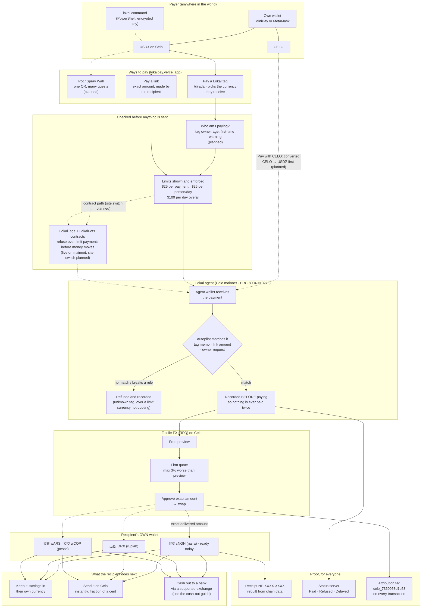
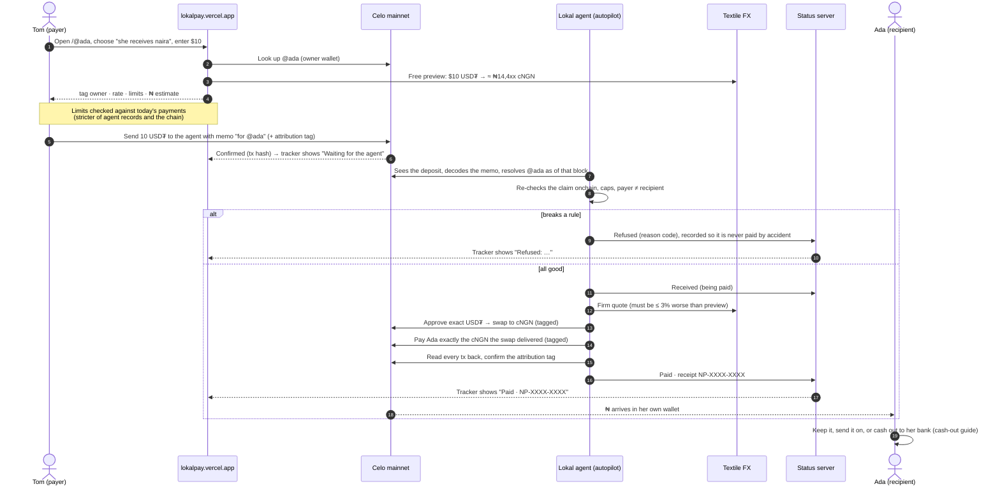

# Lokal: pay anyone in their local money

Formerly Naira Payout.

Send dollars, they receive their local money: an agent on Celo that converts USD₮ to a local stablecoin on Textile FX
and pays the recipient's own wallet, by Lokal tag, payment link or command line, with every limit enforced in code.

Multi-currency by design: the payer chooses what the recipient gets, **naira** (cNGN, Nigeria), **rupiah** (IDRX,
Indonesia) or **pesos** (wARS, Argentina; wCOP, Colombia), and the agent pays out in that currency through the same
safety path. All four are built and tested; none has had a real mainnet payout yet. See [Currencies](#currencies).

> **Status today.** Every feature carries one of three labels, used the same way on the site:
> **Live** (used with real money on Celo mainnet, with a transaction link) ·
> **Built, not yet used on mainnet** (code and tests exist; no real payout yet) ·
> **Planned** (not built yet).
>
> - **Live:** the LokalTags and LokalPots contracts are deployed and verified on mainnet (see
>   [The contract has the final say](#the-contract-has-the-final-say)). No real user payout yet.
> - **Built, not yet used on mainnet:** payouts in naira, rupiah and pesos (plus naira → dollars), the currency
>   picker, Lokal tags, payment links, Get paid, autopilot, the `lokal` command, receipts and reviews, and the
>   [cash-out guide](https://lokalpay.vercel.app/cash-out.html).
> - **Planned:** paying through the contracts from the site, Pots on the site, the "Who am I paying?" card, Pay with
>   CELO for payers, MiniPay mode.

**[Live app](https://lokalpay.vercel.app)** ·
**[Agent on Celoscan](https://celoscan.io/address/0x8a695cf54CB44753c8b784EB36d266f748617a1e)** ·
**[ERC-8004 identity (agentId 10079)](https://celoscan.io/token/0x8004A169FB4a3325136EB29fA0ceB6D2e539a432?a=10079)** ·
**[Docs](https://lokalpay.vercel.app/docs.html)** ·
[GitHub Pages mirror](https://deeeko.github.io/lokal/)

Built for the **Agents Open for Business** hackathon on Celo, **Track 3: Stablecoin Corridors (Textile FX)**
(deadline 7 Dec 2026). Runs on **Celo mainnet** (chain 42220).

| | |
|---|---|
| Agent wallet | [`0x8a695cf54CB44753c8b784EB36d266f748617a1e`](https://celoscan.io/address/0x8a695cf54CB44753c8b784EB36d266f748617a1e) |
| ERC-8004 identity | agentId **10079** in the Identity Registry [`0x8004A169FB4a3325136EB29fA0ceB6D2e539a432`](https://celoscan.io/address/0x8004A169FB4a3325136EB29fA0ceB6D2e539a432) |
| ERC-8004 reputation | Reputation Registry [`0x8004BAa17C55a88189AE136b182e5fdA19dE9b63`](https://celoscan.io/address/0x8004BAa17C55a88189AE136b182e5fdA19dE9b63) |
| LokalTags (tags + payments) | [`0xFF2f8ADC0c97B6E40b201848d378C11325bC7187`](https://celoscan.io/address/0xFF2f8ADC0c97B6E40b201848d378C11325bC7187) · source verified on [Sourcify](https://repo.sourcify.dev/42220/0xFF2f8ADC0c97B6E40b201848d378C11325bC7187) (exact match) |
| LokalPots (pots) | [`0x60F76b5d1dc6a9B1e208fB93f6C0B05De51a7DAF`](https://celoscan.io/address/0x60F76b5d1dc6a9B1e208fB93f6C0B05De51a7DAF) · source verified on [Sourcify](https://repo.sourcify.dev/42220/0x60F76b5d1dc6a9B1e208fB93f6C0B05De51a7DAF) (exact match) |
| Attribution tag (ERC-8021) | `celo_7360953d1b53`, on every transaction the agent sends **and** on every transaction the site asks a user's wallet to send (tag claims, payments, registrations, ratings) |
| USD₮ | [`0x48065fbBE25f71C9282ddf5e1cD6D6A887483D5e`](https://celoscan.io/address/0x48065fbBE25f71C9282ddf5e1cD6D6A887483D5e) (6 decimals) |
| cNGN (naira) | [`0xF6829D7393dAe24509eb1E52eE8e572e2E271a4f`](https://celoscan.io/address/0xF6829D7393dAe24509eb1E52eE8e572e2E271a4f) (6 decimals) |
| IDRX (rupiah) | [`0x18Bc5bcC660cf2B9cE3cd51a404aFe1a0cBD3C22`](https://celoscan.io/address/0x18Bc5bcC660cf2B9cE3cd51a404aFe1a0cBD3C22) (2 decimals) |
| wARS (Argentine peso) | [`0x0DC4F92879B7670e5f4e4e6e3c801D229129D90D`](https://celoscan.io/address/0x0DC4F92879B7670e5f4e4e6e3c801D229129D90D) (18 decimals) |
| wCOP (Colombian peso) | [`0x8a1D45e102e886510e891d2Ec656a708991e2D76`](https://celoscan.io/address/0x8a1D45e102e886510e891d2Ec656a708991e2D76) (18 decimals) |
| CELO (GoldToken) | [`0x471EcE3750Da237f93B8E339c536989b8978a438`](https://celoscan.io/address/0x471EcE3750Da237f93B8E339c536989b8978a438) (18 decimals) |
| Textile LimitOrderReactor | [`0xa9AA0a64769cBed4d3B1Ceb4Df01CdE915C235b3`](https://celoscan.io/address/0xa9AA0a64769cBed4d3B1Ceb4Df01CdE915C235b3) (per the hackathon brief) |

---

## Contents

1. [What it is and who it's for](#what-it-is-and-who-its-for)
2. [Currencies](#currencies)
3. [How people use it](#how-people-use-it)
4. [How a payout works](#how-a-payout-works)
5. [The contract has the final say](#the-contract-has-the-final-say)
6. [Safety and limits, enforced in code](#safety-and-limits-enforced-in-code)
7. [Lokal tag rules](#lokal-tag-rules)
8. [Architecture](#architecture)
9. [Run it yourself](#run-it-yourself)
10. [Progress log](#progress-log)
11. [Business model](#business-model)
12. [Status and roadmap](#status-and-roadmap)
13. [License](#license)

---

## What it is and who it's for

Someone abroad wants to send money home. They hold dollars (USD₮) on Celo; the recipient wants their local money.
Lokal's agent sits in the middle: it takes the dollars, converts them to a local stablecoin on **Textile FX**, and pays
the recipient's own Celo wallet. It is built for families and freelancers across **Nigeria, Indonesia, Argentina and
Colombia**: @ada can receive naira; @budi will receive rupiah once the rupiah payouts ship (see
[Currencies](#currencies)).

The agent pays out end to end in **cNGN** (naira), **IDRX** (rupiah), **wARS** and **wCOP** (pesos). The naira corridor also runs the other way
(naira in, dollars out), and the operator can pay out in naira from the agent's CELO. The corridors below are the ones
the agent runs.

- **Senders** pay from any Celo wallet: to a **Lokal tag** (a short handle), through a **payment link**, from the site,
  or from the **`lokal` command line** in PowerShell.
- **Recipients** get paid straight into their own wallet. They can claim a Lokal tag and share `lokalpay.vercel.app/@name`,
  or publish a payment link from their own wallet ("Get paid").
- **The operator** runs the agent (`src/agent.mjs`): it watches for deposits (`watch --execute`) and pays them out,
  under hard limits.

The site is **non-custodial**: it never holds keys or money. Every payment a page asks for is sent from the user's own
wallet. The agent holds only what it is converting at that moment.

| Corridor | Payer sends | Recipient gets | Amount typed in | Used by |
|---|---|---|---|---|
| `usdt-cngn` (default) | USD₮ | cNGN | USD₮ | Lokal tags, payment links, Get paid, CLI, operator |
| `cngn-usdt` | cNGN | USD₮ | naira (cNGN) | Lokal tags, payment links, Get paid, CLI, operator |
| `usdt-idrx` | USD₮ | IDRX | USD₮ | Lokal tags, payment links, Get paid, CLI, operator |
| `usdt-wars` | USD₮ | wARS | USD₮ | Lokal tags, payment links, Get paid, CLI, operator |
| `usdt-wcop` | USD₮ | wCOP | USD₮ | Lokal tags, payment links, Get paid, CLI, operator |
| `celo-cngn` | CELO (from the agent wallet) | cNGN | CELO | operator `pay` and `quote` only |

---

## Currencies

Lokal is multi-currency by design. Every local stablecoin below is on Celo mainnet and is priced by Textile FX against
USD₮. The payer picks the currency; all four are built, not yet used on mainnet.

| Country | Token | Issuer | Decimals | Today's rate (5 USD₮) | Status |
|---|---|---|---|---|---|
| 🇳🇬 Nigeria | [cNGN](https://celoscan.io/address/0xF6829D7393dAe24509eb1E52eE8e572e2E271a4f) (naira) | — | 6 | ₦7,205.67 | **Built, not yet used on mainnet** (USD₮ → cNGN, cNGN → USD₮, and CELO → cNGN for the operator) |
| 🇮🇩 Indonesia | [IDRX](https://celoscan.io/address/0x18Bc5bcC660cf2B9cE3cd51a404aFe1a0cBD3C22) (rupiah) | — | 2 | Rp 92,035.51 | **Built, not yet used on mainnet** (`usdt-idrx`) |
| 🇦🇷 Argentina | [wARS](https://celoscan.io/address/0x0DC4F92879B7670e5f4e4e6e3c801D229129D90D) (peso) | Ripio | 18 | ARS 8,826.31 | **Built, not yet used on mainnet** (`usdt-wars`) |
| 🇨🇴 Colombia | [wCOP](https://celoscan.io/address/0x8a1D45e102e886510e891d2Ec656a708991e2D76) (peso) | Ripio | 18 | COP 17,277.91 | **Built, not yet used on mainnet** (`usdt-wcop`; thin market: Textile could fill only about $6.71 on 21 Nov, so larger payments are refused, never switched) |

- **Rates** are live Textile FX previews for 5 USD₮ taken on 21 Nov 2026. They are free previews, not firm quotes, and
  they move; every payment gets its own firm quote at the time it is paid.
- **What "Built, not yet used on mainnet" means.** Payments by Lokal tag, payment link, Get paid or the `lokal` CLI are paid out by the
  agent (by hand or on autopilot) in cNGN, plus the reverse corridor that pays USD₮. The flow is built and tested against
  live Textile quotes; the first real mainnet payout to a user is still pending and will be linked here with its
  transactions. No payout in IDRX, wARS or wCOP has been made yet.
- **How the currency is chosen.** On the site and in the `lokal` command the payer picks it ("They receive"). A Lokal
  tag payment carries it in its memo, `NTP:<tag>:<code>` (`idrx`, `wars`, `wcop`; plain `NTP:<tag>` still means
  naira, so existing payers keep working), and a tag owner can set a preferred currency that pay pages pre-select.
  Payment links and Get paid fix the currency in the link. Every amount uses the token's own decimals (IDRX 2, cNGN 6,
  wARS and wCOP 18) and is shown rounded down. If a currency has no Textile quote when the payment is handled, the
  payment is refused (`currency_unavailable`) and never paid in another currency.
- **Getting it to a bank.** The [cash-out guide](https://lokalpay.vercel.app/cash-out.html)
  ([docs/CASH-OUT.md](docs/CASH-OUT.md)) gives each currency's checked route as of 21 Nov 2026. MiniPay only shows
  USDT, USDC and USDm, so recipients who cash out through MiniPay should take dollars.
- **Not yet supported.** Textile also lists wBRL (Brazil) and wMXN (Mexico), but neither returned a quote on 21 Nov, so
  Lokal does not offer them.

---

## How people use it

The site has six sections in its sidebar, each with a small tab strip for related pages:

| Section | Tabs |
|---|---|
| Overview | sign in, find a Lokal tag, live stats, quote and activity |
| Send | Quote · Pay a link (plus the public tag pages, `/@tag`) |
| Get paid | Payment link · Your Lokal tag |
| Activity | Transactions · Receipts · Verify |
| Agent | Identity · Autopilot |
| Docs | Docs · Privacy · Terms |

Every payment screen shows the limits: **$25 per payment, $25 per person per day, $100 per day overall**.

### Lokal tags: get paid at @yourname

A Lokal tag is a handle like `@ada` tied to one Celo wallet. People pay the tag; the agent pays the wallet that holds it.

1. **Sign in with your wallet** (`account.html`). Connect a wallet and sign a short sign-in message (EIP-4361 style,
   via `personal_sign`). It is free, sends nothing, and needs no password. The session (address, message, signature,
   expiry; 7 days) is kept in your browser under `np-session`. Signing out deletes it and disconnects the wallet.
   On Vercel the signature is checked by `POST /api/session` (see [Safety](#safety-and-limits-enforced-in-code)).
2. **Your name.** The setup guide (Sign in → Your name → Claim your Lokal tag → Done) asks for an optional display name
   (1–40 characters).
3. **Claim your @tag.** Type a tag; availability is checked live as you type (free, yours, taken, reserved, locked or
   invalid, with the exact rule broken), with suggestions when it is taken and a live preview of your tag card. You
   confirm that tags and names are **public and permanent**, then send one zero-value transaction from your wallet to
   the agent. Its input is `hex("NT1:" + JSON)` plus the attribution tag, for example `{"t":"ada","n":"Ada Obi"}`.
   The page waits for the explorer to index it and confirms the tag is yours (or explains if someone claimed it a
   moment earlier).
4. **Share** `https://lokalpay.vercel.app/@ada` (on the GitHub Pages mirror: `tag.html#ada`), with a QR code and a
   WhatsApp button. The account page also shows your wallet balances (USD₮, the local stablecoin, CELO; today cNGN) and the payments to your tag
   with receipt links. You can change your tag or release it (`{"t":""}`) from the same page.

**Paying a tag** (`tag.html`, or `/@ada` on Vercel): the public tag page shows the owner's name, short address and
"since" date. The payer picks what the owner receives: **naira, rupiah, Argentine peso or Colombian peso** (send
USD₮), or **dollars** (send cNGN). The owner's preferred currency, if set, is pre-selected. They type an amount
(a live estimate is shown, plus how much more the owner can receive today), connect a wallet and confirm. The page
checks the balance and that the payer is not the owner, then sends **one** ordinary ERC-20 transfer to the token
contract:

```
transfer(agent, amount)  +  hex("NTP:" + tag)  +  attribution suffix
```

The extra bytes after the standard 68 bytes of calldata are the **NTP memo**. Token contracts ignore them; the agent
reads them to know who the payment is for. After sending, the page tracks the payment live: confirmed on Celo, then
the agent's payout to the owner, ending in **"Paid · NP-XXXX-XXXX"** with a receipt link. Tracking survives a page
reload.

### Payment links ("Get paid")

`get-paid.html` lets someone publish a payment request **from their own wallet**: one zero-value transaction to the
agent whose input is `hex("NP1:" + JSON)` plus the attribution tag:

```json
{ "a": "5.03", "d": "usdt-cngn", "e": 1796000000, "n": "Ada", "m": "school fees" }
```

(`a` amount, `d` corridor, `e` expiry in unix seconds, at most 168 hours, `n` name, `m` optional note.) The recipient
is the transaction's sender, proven by its signature, so the address cannot be mistyped. The link is
`pay.html#tx=<registration hash>`. Name, note, amount and wallet are public and permanent onchain.

The operator can also create links for allow-listed contacts from the command line (`request`), which gives
`pay.html#r=<token>` with a unique amount (see [Run it yourself](#the-agent-cli)).

### Pay a link

The payer opens the link and sees who is paid, the exact amount, the corridor, the expiry and a live estimate. They
can **connect a wallet and pay** in one step (the page builds the exact transfer plus the attribution suffix, checks
the network is Celo and refuses the agent's own wallet), or use "Open in wallet", the QR code, or send the exact
amount by hand. When several "Get paid" links use the same corridor and amount, only the earliest is **active**; the
others show **amount in use** and are never paid.

### Quotes ("Send")

`quote.html` gives a free live Textile FX price for every corridor: USD₮ → naira, rupiah, Argentine or Colombian
pesos (pick one under "They receive"), naira → USD₮, and "From CELO" (a two-swap estimate, operator-only). The rate comes from `/api/rate` (Textile, cached for 60 s at
the edge), with a static `rate.json` fallback refreshed every 30 minutes.

### Activity, receipts and reviews

- **Transactions** (`transactions.html`): every transaction sent from the agent wallet, with the attribution tag
  decoded from each one's own calldata. Filters: All, **Yours** (shown when signed in: your wallet's payments to and from
  the agent), Payouts, Conversions, Approvals, Identity.
- **Receipts** (`receipt.html`): every executed payout gets a number `NP-` + the first 8 hex characters of the payout
  transaction hash, upper-case (for example `NP-7F3A-91C2`), so anyone can work it out from the chain. The receipt page
  finds a payout by number or hash and rebuilds it from Celo in the browser: payout, swap, effective rate and each
  transaction's tag. It can be saved as an image or PDF, shared on WhatsApp or as a QR code.
- **Reviews**: from a receipt, the payer can rate the payout 1–5 stars with a `giveFeedback` transaction to the ERC-8004
  Reputation Registry, sent **from their own wallet**. The registry rejects ratings from the agent's owner or operators.
  The Agent page lists the ratings; "Verified payer" is our own check that the reviewer has sent USD₮ or a local
  stablecoin (today cNGN) to the agent, since the registry cannot check that.
- **Verify** (`verify.html`): paste any Celo transaction hash to see its attribution tag.

### Pay from CELO (operator)

Textile has no CELO → cNGN pair, so `celo-cngn` is **two swaps and two Textile fees**: CELO → USD₮, then exactly the
USD₮ that arrived → cNGN, then the cNGN received is paid out (`src/celo.mjs`). Each swap must clear Textile's minimum of
about $1, so the first swap must preview at least **1.05 USD₮** (about 20 CELO at today's rate). The agent always keeps
**2 CELO** (`MIN_CELO_RESERVE`) plus a **0.1 CELO** gas margin after selling, because CELO also pays its network fees.
It is for direct operator payouts only: payment links, "Get paid" and autopilot refuse it. If the second swap or the
payout fails after the first swap went through, the agent stops and prints where the money is (for example
"1.091835 USDT is in the agent wallet") and the exact command that finishes the job.

```powershell
node src/agent.mjs quote --corridor celo-cngn --amount 20
node src/agent.mjs pay --to ada --amount 20 --corridor celo-cngn            # dry run
node src/agent.mjs pay --to ada --amount 20 --corridor celo-cngn --execute  # real, asks you to type yes
```

### The `lokal` command line (PowerShell)

`src/ntag.mjs` (the `lokal` command; `ntag`, its name before the rename, runs the same thing) lets anyone pay a Lokal
tag from **their own wallet** in a terminal. It never touches the agent's key and
refuses to use it.

#### Install the lokal command (Windows)

The quickest way, for anyone: open PowerShell (no admin needed) and paste

```powershell
irm https://lokalpay.vercel.app/install.ps1 | iex
```

Requirement: **Node.js 20 or newer**. If it is missing or too old, the installer says how to get it
(`winget install OpenJS.NodeJS.LTS` or https://nodejs.org) and stops; it never installs system software itself.
You can read [`site/install.ps1`](site/install.ps1) (served as plain text at the URL above) before running it. It:

1. checks for Node.js 20+ and npm;
2. downloads the code as a zip from GitHub (`codeload.github.com/deeeko/lokal/zip/<ref>`, `main`
   unless `$env:NTAG_REF` names a branch, tag or commit), over TLS 1.2 in Windows PowerShell 5.1 too;
3. runs `npm ci --omit=dev --ignore-scripts --no-audit --no-fund` in a staging folder and checks that `lokal help` runs;
4. swaps it into `%LOCALAPPDATA%\lokal\app` with a rename (a failed update keeps the previous install);
5. writes `%LOCALAPPDATA%\lokal\bin\lokal.cmd`, plus `ntag.cmd` (the command's old name, so `ntag` keeps working),
   and adds that folder to your **user** PATH (and to the current window). `$env:NTAG_NO_PATH = "1"` skips the PATH
   change and prints the folder to add instead;
6. cleans up an install from before the rename to Lokal: deletes `%LOCALAPPDATA%\naira-payout\app` and `bin` and takes
   the old bin folder out of your user PATH, so the old `ntag` can never shadow the new one.

Then: `lokal wallet new`, send USD₮ and a little CELO (for fees) to the address `lokal wallet` shows, `lokal whois ada`,
`lokal send ada 10`. `ntag` still works as another name for the same command. Written for both Windows PowerShell 5.1
(built into Windows) and PowerShell 7.

- **Update:** run the same line again.
- **Uninstall:** `$env:NTAG_UNINSTALL = "1"; irm https://lokalpay.vercel.app/install.ps1 | iex` removes the app
  and bin folders and the PATH entry. By hand: delete both folders and remove the bin folder from your user PATH.
- **Your wallet is separate:** `%USERPROFILE%\.lokal\wallet.json` (or `NTAG_WALLET_FILE`). The installer never
  creates, reads, moves or deletes it, so updates and uninstalls keep it. Back it up, for example
  `Copy-Item $HOME\.lokal\wallet.json D:\backup\`, and remember the send password.
- **Wallets made before the rename** stay at `%USERPROFILE%\.naira-payout\wallet.json`. When that file exists and the
  new one doesn't, `lokal` keeps using it where it is and says so once; nothing is moved for you.

**Setup** (from a checkout of this repo, any OS)

```powershell
cd lokal
npm install
npm link                          # optional: makes "lokal" (and "ntag") a command; otherwise use "node src/ntag.mjs" or "npm run lokal --"

lokal wallet new                  # creates a wallet, encrypted with a send password you choose (min 8 characters, typed twice)
lokal wallet import               # or use a key you already have (typed at a hidden prompt, or NTAG_PRIVATE_KEY)
lokal wallet                      # address, CELO / USD₮ / cNGN balances and your Lokal tag
```

The wallet file (default `%USERPROFILE%\.lokal\wallet.json`, or the older `.naira-payout\wallet.json` if only that exists; override with `NTAG_WALLET_FILE`) holds the key
encrypted with **scrypt (N = 131072) and AES-256-GCM**; on Windows its permissions are limited to your user. `lokal`
never shows or exports the key and never overwrites an existing wallet. There is no recovery: back up the file and
remember the password; if you forget it, re-import your own key backup with a new password.

**Pay someone**

`send` pays in the tag owner's preferred currency, or naira if they have none. Choose another with `--to`
(`lokal send ada 10 --to rupiah`; names, codes and ISO codes all work), or dollars with `--dollars`.

In PowerShell, `@` at the start of an argument is special. Leave it out (`ada`) or quote it (`'@ada'`).

```powershell
lokal whois ada                   # who owns @ada, and how much more they can receive today
lokal send ada 10                 # you send $10 USD₮, @ada gets naira
lokal send ada 14000 --dollars    # you send ₦14,000 cNGN, @ada gets dollars (USD₮)
lokal send ada 10 --wait          # after sending, wait for the agent's payout and print the receipt number
lokal send ada 5.50 --dry-run     # show the exact transaction (to / data / value), send nothing
lokal status 0x<txhash>           # is that payment confirmed and paid out?

npm run lokal -- send ada 10 --wait              # the same without npm link
node src/ntag.mjs send '@ada' 5.50 --dry-run
```

What `send` does, in order: checks the tag and re-reads its claim onchain; refuses your own tag; checks your token
balance and CELO for gas; checks the owner's remaining $25-per-day allowance and refuses a payment the agent would not
pay automatically; prints a summary with the estimate and today's limits; asks you to **type the tag** to confirm
(`--yes` skips this for scripts); asks for the **send password**; re-checks the owner right before signing; sends and
waits for confirmation.

Amounts: USD₮ $1.00 to $25.00; cNGN worth at least $1 and up to about $24 in naira (3% under the agent's $25 limit, so
a price move cannot push it over). At most 2 decimals; `$10.29`, `₦14,000` are accepted.

**Your own tag**

```powershell
lokal claim ada --name "Ada Obi"  # claim @ada for your wallet (public and permanent)
lokal release                     # give up your tag (locked for you for 30 days)
lokal wallet password             # change the send password (old one, then the new one twice)
```

**Send password and lockout**: `send`, `claim` and `release` ask for the password after you confirm, before anything is
signed. 3 tries per command; **5 wrong passwords in 10 minutes lock the wallet for 5 minutes**. For scripts,
`NTAG_PASSWORD` (and `NTAG_OLD_PASSWORD` for `wallet password`) answer the prompts; that is less safe, because other
programs can read environment variables.

| Option | Meaning |
|---|---|
| `--dollars` | pay in cNGN so the owner gets dollars (default `--naira`: pay USD₮, owner gets naira) |
| `--yes`, `-y` | skip typing the tag to confirm |
| `--wait` | wait for the agent's payout (up to 30 minutes, `NTAG_WAIT_MINUTES`) and print the receipt number |
| `--dry-run` | show the exact transaction and send nothing (works without a wallet) |
| `--name "..."` | display name for `claim` (1–40 characters) |

Settings: `NTAG_WALLET_FILE`, `CELO_RPC_URL` (default Forno), `NTAG_PASSWORD`, `NTAG_OLD_PASSWORD`, `NTAG_PRIVATE_KEY`
(for `wallet import`), `NTAG_WAIT_MINUTES`, `NO_COLOR`.

---

## The whole journey, end to end

### 1. Every path money can take

How dollars (or CELO) sent from anywhere become naira, rupiah or pesos in someone's own wallet, what is checked on the
way, and what the recipient can do next. Solid arrows are live today; dashed arrows are being rolled out (marked in
the labels).



### 2. One payment, step by step

Ada (in Lagos) has claimed `@ada` and prefers naira. Tom (in London) pays her $10 from his own wallet.



---

## How a payout works

**One payout** (`pay` in `src/pay.mjs`), the same for both stablecoin corridors and for every way of paying:

1. **Preview.** Checks the recipient (allow-listed contact, or a wallet that passes the recipient rules) and the caps,
   and gets a free Textile FX preview. A dry run stops here.
2. **Firm quote.** With `--execute`: checks both tokens report 6 decimals (true of USD₮ and cNGN; IDRX uses 2 and the
   pesos 18, which the per-currency payouts will handle), the wallet holds the amount and about 0.02
   CELO, asks the operator to type `yes` (autopilot passes this), then gets a firm quote and checks it against the
   preview: at most **3% worse** and never asking for more than the amount.
3. **Swap.** Approves exactly what the quote needs on the sold token, to a contract the agent builds itself (not taken
   from the quote), resetting an old allowance first. Broadcasts Textile's swap. An expired quote is never sent.
4. **Pay the exact delivered amount.** Pays the recipient the *measured* balance change of the bought token, capped at
   what the swap itself delivered, never an assumed amount.
5. **Verify the tag on every transaction.** Reads every transaction back from the chain and flags any missing the
   attribution tag (the run exits non-zero), logs the payout to `receipts.jsonl` and prints the receipt number and link:

   ```
   Receipt NP-7F3A-91C2: https://lokalpay.vercel.app/receipt.html#NP-7F3A-91C2
   ```

Every transaction the agent sends (reset, approval, swap, payout, identity registration) carries `celo_7360953d1b53`,
attached once where the wallet client is built (`src/chain.mjs`) with `@celo/attribution-tags`.

### Autopilot (`watch --execute`)

`watch` reads ERC-20 Transfer events to the agent on USD₮ and cNGN (Forno `eth_getLogs`, at most 5000 blocks per
query) and decides what each deposit is for. It scans only up to the block Blockscout has indexed, so a fresh
registration or tag claim is never missed. Its block cursor is saved in `watch-state.json`, so after a restart it picks
up deposits that arrived while it was off. RPC errors back off up to 5 minutes; Ctrl+C stops cleanly between steps.

| Deposit | Matched when | Pays |
|---|---|---|
| **Lokal tag payment** | the transfer calldata carries a valid `NTP:<tag>` memo | the wallet that held the tag just before the deposit (by block and position) |
| **Operator request** (`request`) | sell token, **exact** amount, after creation and before expiry | the allow-listed contact |
| **"Get paid" registration** | the **active** registration for that token and exact amount, at the deposit's block time | the registration's sender |

Rules that hold for all three:

- **Memo payments are never amount-matched.** A deposit with a Lokal tag memo is never matched against requests or
  registrations, and neither is anything that merely *looks like* a Lokal tag attempt (the `NTP:` bytes anywhere in the
  input, also inside a smart-wallet call, or a transfer with unexplained extra bytes). Those are refused unless the memo
  decodes cleanly on a direct transfer.
- **Checks first, then record, then pay.** Before anything is recorded, the claim or registration is **re-read over
  RPC** (success, sent to the agent, same sender, block, position, block time, content, zero value), and the recipient
  rules, caps and a live preview run. The deposit is then **recorded before paying** (`requests.json`,
  `registrations-state.json` or `ntag-payments.json`), so a crash can never pay it twice.
- **Refusals are recorded.** Self-payment, a blocked recipient, an unknown tag, a Lokal tag payment under $1, a claim or registration that does not
  check out, or a per-payment / per-wallet cap (also when only the firm quote breaks it) is logged as
  `refused_deposit` and recorded as handled, so a rescan never pays it. The money stays in the agent wallet; for Lokal tag
  payments the operator can pay one later by hand with `retry --ntag <tx>:<logIndex> --force-refused` (every cap
  applies again).
- **Stops instead of guessing.** The global daily cap or a missing price stops autopilot *without* recording anything,
  with the cursor pinned before the deposit, so it matches again once the cause is fixed. A payout error is saved and
  autopilot stops; `retry` finishes it, and refuses once a swap or payout transaction was sent.
- **Exactly once, even when a write fails.** A deposit counts as handled only once its handling finished, writes
  included. If the "paid" record cannot be saved after a payout, autopilot stops and says the deposit **was** paid, so
  it is never retried.
- **Ambiguous or unmatched deposits are never paid.** A deposit matching both an operator request and a registration
  is logged as `ambiguous_deposit`. Unmatched deposits are logged. The agent's own swap output is ignored.
- Without `--execute`, `watch` prints what it would do and writes nothing.

Operator requests add a random 0.01–0.99 to the amount so it is unique among open requests (and still within the
per-payment cap), and avoid the amounts of active "Get paid" links.

---

### Status server (exact payout status on the site)

Autopilot reports what it did with each deposit to the site's `/api/status`: **paid** (with its receipt number),
**refused** (with a reason code), or **received** and being paid now, plus the owner's direct payouts. The site then
shows exact facts and today's exact room under the limits, marked "Live status from the agent". Whenever the status
server is unavailable or has no record, the site estimates from the Celo chain as before, marked "Estimated from Celo".

- **Only public facts are stored:** addresses, transaction hashes, amounts, the tag and the receipt number, plus each
  deposit's status and a refusal reason code. They live in one private Vercel Blob (`status/summary.json`) for 30 days.
- **Only the agent can write.** Reports are signed with a shared secret (HMAC-SHA256 over the timestamp and the exact
  body, valid for 5 minutes, timing-safe check). The secret is set in the site's `NP_STATUS_SECRET` and on the agent's
  PC (`NP_STATUS_SECRET` or the file `status-secret` next to the agent key), never in the repo. Without it, reporting
  is simply off.
- **It can never affect a payout.** Reports are appended to `status-outbox.jsonl` and sent in the background with
  retries; a failing or slow status server never blocks, delays or changes what autopilot pays. A payout that fails is reported as "failed" and shown as "Payout delayed".
- **One read per request.** `GET /api/status?tx=…`, `?recipient=…` or `?tag=…` reads the summary once and is cached
  at the edge for 10 seconds. The site always uses the stricter of the agent's fresh totals and the chain for "room today", so a stale report can never let a payer send over a limit.
- `node src/agent.mjs status-sync` checks the setup and sends anything waiting; `--backfill` re-sends every saved
  record from the last 30 days (run it once after the first deploy).

---

## The contract has the final say

**The agent decides; the contract has the final say.** Two Solidity contracts check the rules *before* any money moves,
so a payment that breaks a limit is refused by Celo itself instead of being refunded later:

- **`LokalTags`**: the Lokal tag registry and payment router. Claim a tag, choose the currency you want to receive,
  and get paid with `payTag` / `payTagWithPermit` (USD₮ supports EIP-2612, so one signature replaces the approval).
  Limits per payment, per recipient per day, per payer per day and overall per day, per token, in that token's own units.
- **`LokalPots`**: one link, many payers (weddings, birthdays, group gifts). A pot has a dollar cap, a per-guest cap and
  a closing time, and takes any allowed token.
- **`LokalText`**: the text rules both contracts share, byte for byte the same as the site's.

Neither contract ever holds money: every payment goes straight to the agent's payout wallet in the same transaction,
and the agent converts it on Textile FX and pays the recipient. A new payout wallet waits 24 hours in public before it
takes effect; the admin (a separate wallet from the agent) can pause everything with one switch.

[](https://github.com/deeeko/lokal/actions/workflows/contracts.yml)
Solidity 0.8.30 · OpenZeppelin 5.6.1 · Hardhat + TypeScript · 127 tests, including the independent audit's attack
scenarios and a parity test that checks the contract against the site's live rules on thousands of random names.

**One command, the whole story.** `cd contracts && npm ci && npm run demo` deploys both contracts on a local chain and
plays out the table below. Every row is asserted, and CI runs it on every push, so this README can't drift from the code.

| # | Who | Action | Result | Why |
| --- | --- | --- | --- | --- |
| 1 | ada | Claim @ada | **ALLOW** | `TagClaimed`: @ada is hers |
| 2 | ada | Ask to be paid out in cNGN | **OK** | `ReceiveTokenSet`: the agent now knows her local currency |
| 3 | bob | Claim @ada | **REFUSE** | `TagTaken` |
| 4 | bob | Claim @lokal_support | **REFUSE** | `TagReserved` (brand names and lookalikes) |
| 5 | carol | Pay @ada $10 USD₮ | **ALLOW** | $10 goes straight to the agent's payout wallet; the contract holds $0 |
| 6 | carol | Pay @ada $30 USD₮ | **REFUSE** | `OverPaymentLimit` ($25): nothing moved |
| 7 | carol | Pay @ada $0.50 USD₮ | **REFUSE** | `BelowMinimum` ($1) |
| 8 | dave | Pay @ada $20 USD₮ ($10 already today, $25 per person per day) | **REFUSE** | `OverRecipientDailyLimit` ($15 left) |
| 9 | carol | Pay @bob $20 USD₮ (she paid $10 today, $25 per payer per day) | **REFUSE** | `OverPayerDailyLimit` ($15 left) |
| 10 | ada | Pay @ada $5 USD₮ | **REFUSE** | `SelfPayment` |
| 11 | carol | Pay @nobody $5 USD₮ | **REFUSE** | `TagNotFound` |
| 12 | carol | Pay @ada in a token the admin never allowed | **REFUSE** | `TokenNotAllowed` |
| 13 | carol | Pay @ada 446,369 IDRX (2 decimals, about $24) | **ALLOW** | Limits are per token, in its own units |
| 14 | 10 other payers | Pay @ada $15 and nine other tags $25 each in USD₮ | **ALLOW** | $250 in USD₮ today: the daily total, and it took 10 different payers |
| 15 | dave | Pay @hank $1 USD₮ | **REFUSE** | `OverDailyLimit` |
| 16 | carol | Next UTC day: pay @ada $25 USD₮ | **ALLOW** | A new day bucket: limits start again |
| 17 | ada | Claim @ada_obi | **ALLOW** | One tag per wallet: @ada is released and locked for 30 days |
| 18 | bob | Claim @ada | **REFUSE** | `TagLocked` |
| 19 | bob | Claim @ada 30 days later | **ALLOW** | The lock has ended |
| 20 | ada | Open a pot, "Ada & Tunde's wedding" ($20 cap, $5 per guest, closes in 6 hours) | **OK** | `PotCreated` #1: one link and QR code for every guest |
| 21 | guest 1 | Spray $2 USD₮ into the pot | **ALLOW** | `PotPaid`: straight to the payout wallet, pot total $2 |
| 22 | guest 1 | Spray $4 more | **REFUSE** | `OverPayerCap` ($3 left for this guest) |
| 23 | guests 2-4 | Spray $5 each, in USD₮, cNGN and IDRX | **ALLOW** | One pot takes any allowed token: $17 from 4 guests |
| 24 | guest 5 | Spray $5 | **REFUSE** | `PotFull` ($3 left of the $20 cap) |
| 25 | admin | Switch the payout wallet right away | **REFUSE** | `PayoutWalletNotReady`: a new payout wallet waits 24 hours, in public |
| 26 | admin | Pause | **OK** |  |
| 27 | carol | Pay @ada_obi $5 USD₮ | **REFUSE** | `Paused` |
| 28 | guest 5 | Spray $1 | **REFUSE** | `Paused`: one switch stops tags and pots |

All 28 outcomes asserted. LokalTags and LokalPots held $0 at every step.

**Who enforces what.** Not every rule can live onchain: the swap and the payout happen in the agent's code.
[docs/WHO-ENFORCES-WHAT.md](docs/WHO-ENFORCES-WHAT.md) lists every rule and says whether the contract, the agent or
the site enforces it.

| | |
|---|---|
| Status | **Live on Celo mainnet since 21 Nov 2026.** Deployed by the agent with the ERC-8021 tag ([LokalTags tx](https://celoscan.io/tx/0x4d4aa9adba3417e9a7017a4c2e45b4cafe2380702e75f6f9350af7ac58af858e), [LokalPots tx](https://celoscan.io/tx/0x8e56d2a9e391a54589ab9e72d683d8307355c5f8b8fb2dd697bab62b65c3ebd9)). The site and the agent switch to the contracts next; until then tags still work through `NT1:` / `NTP:` transactions and the agent enforces these limits. |
| LokalTags | [`0xFF2f8ADC0c97B6E40b201848d378C11325bC7187`](https://celoscan.io/address/0xFF2f8ADC0c97B6E40b201848d378C11325bC7187) · [Blockscout](https://celo.blockscout.com/address/0xFF2f8ADC0c97B6E40b201848d378C11325bC7187?tab=contract) · [Sourcify, exact match](https://repo.sourcify.dev/42220/0xFF2f8ADC0c97B6E40b201848d378C11325bC7187) |
| LokalPots | [`0x60F76b5d1dc6a9B1e208fB93f6C0B05De51a7DAF`](https://celoscan.io/address/0x60F76b5d1dc6a9B1e208fB93f6C0B05De51a7DAF) · [Blockscout](https://celo.blockscout.com/address/0x60F76b5d1dc6a9B1e208fB93f6C0B05De51a7DAF?tab=contract) · [Sourcify, exact match](https://repo.sourcify.dev/42220/0x60F76b5d1dc6a9B1e208fB93f6C0B05De51a7DAF) |
| ABIs and addresses | [`contracts/deployments/`](contracts/deployments/) (`LokalTags.json`, `LokalPots.json`, constructor arguments, deploy record) |
| Admin | [`0xc2808B63906F48C1BaCaa1E2Ad2e1Cb2A363A070`](https://celoscan.io/address/0xc2808B63906F48C1BaCaa1E2Ad2e1Cb2A363A070) (two-step transfer: [offered](https://celoscan.io/tx/0xd22cf761f5c768dad0b432fa27d0bea927db04ce344de10f3ce26af8dde66bda) by the deployer, [accepted](https://celoscan.io/tx/0xbee2dd85e15c4fb664397f06e1a0a932214c6c6a65aaa3aa99e599905c2ec3a6) from the admin's own wallet. The agent's key is not an admin) |
| Payout wallet | the agent, [`0x8a695cf54CB44753c8b784EB36d266f748617a1e`](https://celoscan.io/address/0x8a695cf54CB44753c8b784EB36d266f748617a1e) |

---

## Safety and limits, enforced in code

All numbers are defaults from `src/config.mjs`; the language-parsing layer of `ask` never decides any of them.

| Rule | Value | Where |
|---|---|---|
| Per payment | **$25** (`MAX_USD`) | `src/guards.mjs`, `src/pay.mjs` |
| Per recipient wallet, rolling 24 h | **$25** (`MAX_WALLET_DAILY_USD`; Get paid and Lokal tag payouts) | `src/guards.mjs`, `src/pay.mjs` |
| Everything the agent pays, rolling 24 h | **$100** (`MAX_DAILY_USD`, counted from `receipts.jsonl`) | `src/guards.mjs` |
| Firm quote vs. preview | at most **3%** worse (`MAX_SLIPPAGE_BPS` = 300), per swap | `src/guards.mjs`, `src/pay.mjs` |
| `cngn-usdt` cap | checked on the preview, the firm quote and the amount actually paid | `src/pay.mjs` |
| CELO reserve | `celo-cngn` keeps **2 CELO** + **0.1 CELO** gas margin; refused below **1.05 USD₮** from swap 1 | `src/guards.mjs`, `src/celo.mjs` |
| Blocked recipients | the agent, the operator's `own_wallets`, the USD₮, cNGN and CELO token contracts, both ERC-8004 registries, the zero address, and the payer | `src/guards.mjs`, `src/pay.mjs` |
| Dry run by default | real money moves only with `--execute`; a manual payout also needs you to type `yes` (or `--yes`) | `src/pay.mjs` |
| Exact approvals | only what each firm quote needs, old allowance reset first; expired quotes never sent | `src/pay.mjs`, `src/celo.mjs` |
| Measured payout | the bought token's balance change, capped at what the swap delivered | `src/pay.mjs`, `src/celo.mjs` |
| Agent key never printed | kept in `~/.celo-naira-agent/agent.json`, outside the repo, git-ignored | `src/chain.mjs` |
| Encrypted CLI wallet | scrypt + AES-256-GCM, send password, 5 wrong in 10 min → 5-minute lockout, refuses the agent's key | `src/ntag.mjs` |
| Non-custodial site | no keys, no funds; every transaction a page asks for is the user's own (claim, payment, registration, rating) | `site/` |
| Stateless sign-in check | `POST /api/session`: JSON only, at most 4 KB, no cookies, no database, nothing stored or logged | `api/session.js` |

**Sign-in check** (`api/session.js`, Vercel only): checks the message is this site's sign-in text, for a known host
(the request's own host, `lokalpay.vercel.app`, or the older `naira-payout.vercel.app` and `celo-naira-payout-agent.vercel.app`), on Celo (chain 42220) and
not expired, and that the address signed it. Normal wallets (EIP-191) are verified locally with viem; smart-contract
wallets (ERC-1271, or ERC-6492 before deployment) are checked on Celo through Forno with an 8-second timeout. Returns
`{ ok, address, exp }`, 400 for a bad sign-in, or 503 if Celo could not be asked in time. On the GitHub Pages mirror and
the local preview there is no server, so the page accepts the signature the wallet returns (stated in the privacy page).

**Other site hardening:** a Content-Security-Policy on every page (`script-src 'self'`, no inline scripts), no
frameworks or CDNs, self-hosted fonts, security headers from `vercel.json`, and a read-only, allow-listed Blockscout
proxy (`/api/explorer`) that can only read public data.

**`ask`** turns "send $10 to ada" into a contact name and an amount with a built-in parser. An optional hosted
language model can handle looser phrasing when its API key is set in the environment (see `src/intent.mjs` and
`.env.example`). Either way it returns only a name and a number; code resolves the name and applies every rule above.
Autopilot never uses it.

---

## Lokal tag rules

| Rule | Detail |
|---|---|
| Format | 3–20 characters: lowercase letters, numbers and `_`, starting with a letter (`^[a-z][a-z0-9_]{2,19}$`), no `__`, not ending in `_`. The onchain JSON must already be lowercase; the site and CLI normalise input (trim, strip one `@`, lowercase). |
| Display name | optional, 1–40 characters, no control characters, no invisible or text-direction characters (zero-width spaces and joiners, bidi marks, overrides and isolates) |
| Reserved (63) | agent, admin, administrator, root, system, support, help, official, team, staff, mod, moderator, security, celo, minipay, valora, opera, textile, naira, nairapayout, payout, payouts, ntag, ntags, lokal, lokalpay, cngn, usdt, usdc, tether, cusd, ceur, wallet, bank, cbn, null, undefined, anonymous, everyone, me, you, test, demo, api, www, app, pay, send, receive, and the lookalikes lokal_support, lokalsupport, lokal_help, lokal_team, lokal_official, lokalofficial, support_team, help_desk, helpdesk, admin1, celo_team, celoteam, minipay_support, textile_fx |
| One tag per wallet | claiming another tag releases the old one |
| Release lock | a released tag stays locked for its previous owner's reclaim only, for **30 days** |
| Ordering | claims are applied in (block, position) order; the first valid claim wins; later claims for a held tag are "taken" |
| Ignored | failed transactions, non-zero value, extra or non-string fields, claims sent by the agent itself |
| Public | tags, names and claim history are onchain, public and permanent |

**Same code on both sides.** The resolver block between the `port` markers in `site/assets/core.js` is copied
byte-for-byte into `src/ntags.mjs`, and `test/ntags.test.mjs` checks the copies are identical and give identical results
on a shared fixture set. The site and the agent therefore always agree on who owns a tag at any moment. For a deposit,
the agent resolves the tag strictly **before** the deposit (`resolveNtagsBefore(ops, block, position)`).

**Discovery.** Tag claims are read from Blockscout (`/addresses/<agent>/transactions?filter=to`). The agent loads the
full list once and then refreshes incrementally, re-reading the last 600 blocks each time so a reorg or late-indexed
block is picked up. It never works from a partial list: past the page limit it stops with an error, and a Lokal tag deposit
above the height the list is complete to waits (requests and registrations before it carry on). Spam sent to the agent
cannot make it pay from a stale or partial list.

---

## Architecture

No framework and no bundler: Node ESM with `viem` and `@celo/attribution-tags` for the agent, and a static site in plain
HTML, CSS and ES modules.

| Path | What it is |
|---|---|
| `src/config.mjs` | addresses, corridors, limits, tag, file paths: everything that touches money |
| `src/guards.mjs` | safety rules: amounts, caps (per payment, per wallet, 24 h), recipients, slippage |
| `src/textile.mjs` | Textile FX RFQ v2 client (previews and firm quotes) |
| `src/pay.mjs` | the payout flow for both stablecoin corridors, preflight checks, blocked recipients |
| `src/celo.mjs` | pay in naira from CELO: two swaps, gas reserve, recovery message |
| `src/requests.mjs` | operator payment requests: unique amounts, link encoding, deposit matching, receipt numbers |
| `src/registrations.mjs` | "Get paid" registrations: decoding, discovery, the same-amount rule (ported from the site) |
| `src/ntags.mjs` | Lokal tags: resolver (byte-identical port of the site's), memo decoding, discovery, onchain claim check, local state |
| `src/watch.mjs` | autopilot: watches deposits and pays requests, registrations and Lokal tag payments |
| `src/ntag.mjs` | the `lokal` CLI (also runs as `ntag`): encrypted wallet, whois, send, claim, release, status |
| `src/agent.mjs` | the operator command line |
| `src/intent.mjs` | plain-language parser for `ask` |
| `src/register8004.mjs` | ERC-8004 registration |
| `src/chain.mjs` | agent wallet and the attribution-tagged client |
| `site/` | the live app: `index`, `quote`, `pay`, `tag`, `get-paid`, `account`, `transactions`, `receipt`, `verify`, `agent`, `autopilot`, `docs`, `privacy`, `terms`, `404` |
| `site/assets/core.js` | shared site code: ABI codec, link formats, registrations, the Lokal tag resolver, explorer and RPC helpers |
| `site/assets/session.js` | wallet sign-in (message, session, Celo network switch, wallet error messages) |
| `site/assets/ntag-ui.js`, `ntags.css` | the tag card, claim and pay UI pieces |
| `api/session.js` | stateless sign-in check |
| `api/rate.js` | live Textile rate, edge-cached 60 s, falls back to the static `rate.json` |
| `api/explorer.js` | read-only, allow-listed, cached Blockscout proxy |
| `lib/rate.mjs` | builds the rate (shared by `api/rate.js` and `scripts/fetch-rate.mjs`) |
| `scripts/vercel-build.mjs` | the Vercel deploy gate |
| `scripts/check-site.mjs` | static site checks: links, assets, CSP, page scripts parse, JSON and SVG valid |
| `scripts/fetch-rate.mjs` | writes `site/rate.json` |
| `scripts/serve.mjs` | local preview server (`node scripts/serve.mjs`, port 4173) |
| `contracts/` | Solidity contracts (`LokalTags`, `LokalPots`, `LokalText`), Hardhat + TypeScript tests, the one-command demo, the deploy script and ABIs (see [The contract has the final say](#the-contract-has-the-final-say)) |
| `docs/WHO-ENFORCES-WHAT.md` | every rule, and whether the contract, the agent or the site enforces it |
| `test/` | 197 unit and integration tests (`node --test`) |
| `.github/workflows/ci.yml` | tests, a syntax check of every script, and the site check on every push and pull request |
| `.github/workflows/contracts.yml` | compiles and tests the contracts and runs the demo (every row asserted) whenever the contracts or the site's tag rules change |
| `.github/workflows/pages.yml` | GitHub Pages mirror: deploys only after tests and the site check pass; refreshes the rate every 30 min (read-only, no secrets) |

**Deploy gate.** Vercel builds with `node scripts/vercel-build.mjs` on every push to `main` (production) and every pull
request (preview). It runs `npm test`, then `node scripts/check-site.mjs`, then refreshes `site/rate.json`. If the tests
or the site check fail, the build exits non-zero and **Vercel does not deploy**. The build also strips internal spec
files from the published site. `vercel.json` adds the `/@:tag` → `tag.html?t=:tag` rewrite, the explorer proxy rewrite,
security headers and cache rules.

---

## Run it yourself

Needs Node.js 20 or newer (CI and the deploy use Node 22).

```powershell
git clone https://github.com/deeeko/lokal.git
cd lokal
npm install
npm test
node scripts/serve.mjs            # preview the site at http://localhost:4173
```

### The agent CLI

```powershell
node src/agent.mjs keygen                      # creates the agent wallet (key is never printed)
node src/agent.mjs status                      # balances, tag, caps, USD paid in the last 24 h, open requests
node src/agent.mjs quote --amount 10           # free live price, no wallet needed
node src/agent.mjs quote --corridor cngn-usdt --amount 14400
node src/agent.mjs quote --corridor celo-cngn --amount 20

node src/agent.mjs pay --to ada --amount 10              # DRY RUN
node src/agent.mjs pay --to ada --amount 10 --execute    # real, asks you to type yes
node src/agent.mjs ask "send $10 to ada"                  # DRY RUN, plain language (usdt-cngn)

node src/agent.mjs request --to ada --amount 5           # payment link with a unique amount
node src/agent.mjs requests                              # open | received | paid | expired
node src/agent.mjs registrations                         # Get paid: active | in-use | expired | invalid | received | paid

node src/agent.mjs watch                                 # autopilot DRY RUN
node src/agent.mjs watch --execute                       # autopilot: pays matched deposits
node src/agent.mjs retry --request r_ab12cd34            # DRY RUN of a failed payout (add --execute)
node src/agent.mjs retry --registration 0x<hash>
node src/agent.mjs retry --ntag 0x<tx>:<logIndex>

node src/agent.mjs ntag ada                              # owner, name, since, claim tx, status (free | taken | locked | ...)
node src/agent.mjs ntags                                 # every tag held right now
node src/agent.mjs pay '@ada' 10                         # DRY RUN: operator payout to a tag owner (add --execute)
node src/agent.mjs pay --ntag ada --amount 10            # the same, PowerShell-friendly
node src/agent.mjs ntag-data '@ada' 10 --token usdt      # the to/data to pay a tag from your own wallet; uses no key

node src/agent.mjs register --execute                    # ERC-8004 identity on Celo mainnet
node src/agent.mjs verify 0x<txhash>                     # shows a transaction's attribution tag
```

`npm start`, `npm run quote`, `npm run requests`, `npm run watch` and `npm run lokal` (or `npm run ntag`) are shortcuts.

| Command | Flags |
|---|---|
| `keygen` | none |
| `status` | none (needs the key file) |
| `quote` | `--amount N` (default 10 USD₮, ₦14,400 or 20 CELO), `--corridor ID` |
| `pay` | `--to NAME --amount N`, `--corridor ID` (incl. `celo-cngn`), `--execute`, `--yes`; or `@tag N` / `--ntag TAG --amount N` (not `celo-cngn`) |
| `ask "TEXT"` | `--execute`, `--yes` (always `usdt-cngn`) |
| `request` | `--to NAME --amount N`, `--corridor ID`, `--note TEXT` (≤ 80 chars), `--hours H` (default 48, at most 168) |
| `requests`, `registrations`, `ntags` | none |
| `ntag <@tag or address>` | none |
| `ntag-data @tag N` | `--token usdt` (default) or `cngn` |
| `watch` | `--execute`, `--interval SECONDS` (default 15, minimum 5) |
| `retry` | `--request ID`, `--registration HASH` or `--ntag TX:LOGINDEX`; `--force-refused` (Lokal tag only), `--execute`, `--yes` |
| `register` | `--repo URL`, `--execute` (needs the key file) |
| `verify <hash>` | none (needs the key file) |

`ID` is `usdt-cngn` (default) or `cngn-usdt`; `pay` and `quote` also take `celo-cngn`. `NAME` must be in `contacts.json`
(case-insensitive): copy `contacts.example.json` to `contacts.json` and add recipients, plus any `own_wallets` the agent
must never pay. Autopilot needs a computer that keeps `watch --execute` running with the key file; it pays only while
running.

### Environment variables

All optional (see `.env.example`).

| Variable | Default | Controls |
|---|---|---|
| `MAX_USD` | `25` | Largest single payout, in USD |
| `MAX_WALLET_DAILY_USD` | `25` | Most USD paid to any one wallet in a rolling 24 h (Get paid and Lokal tag payouts) |
| `MAX_DAILY_USD` | `100` | Most USD paid out in any rolling 24 h |
| `MAX_SLIPPAGE_BPS` | `300` | Allowed gap between preview and firm quote (300 = 3%), per swap |
| `MIN_CELO_RESERVE` | `2` | CELO the agent must still hold after a `celo-cngn` payout |
| `CELO_GAS_MARGIN` | `0.1` | CELO set aside for the gas of a `celo-cngn` payout (up to 7 transactions) |
| `ATTRIBUTION_CODE` | `celo_7360953d1b53` | Tag on every transaction (1–32 chars of a–z, 0–9, _) |
| `AGENT_ADDRESS` | `0x8a695cf54CB44753c8b784EB36d266f748617a1e` | Agent address when there is no key file (`request`, dry-run `watch`) |
| `SITE_URL` | `https://lokalpay.vercel.app` | Site used in payment and receipt links |
| `CELO_AGENT_KEY_FILE` | `~/.celo-naira-agent/agent.json` | Agent private key, outside the repo |
| `CONTACTS_FILE` | `contacts.json` | Allow-list and `own_wallets` |
| `RECEIPTS_FILE` | `receipts.jsonl` | Executed payouts and refused or unmatched deposits; the daily caps are counted from it |
| `REQUESTS_FILE` | `requests.json` | Operator payment requests |
| `WATCH_STATE_FILE` | `watch-state.json` | Autopilot block cursor (written only with `--execute`) |
| `REGISTRATIONS_STATE_FILE` | `registrations-state.json` | "Get paid" deposits and payouts |
| `NTAG_PAYMENTS_FILE` | `ntag-payments.json` | Lokal tag deposits seen by autopilot, keyed by `tx:logIndex` |
| `BLOCKSCOUT_API` | `https://celo.blockscout.com/api/v2` | Where registrations and tag claims are discovered |
| `CELO_RPC_URL` | Forno | RPC for `watch`, the agent's read commands and the `lokal` CLI |
| `TEXTILE_API` | `https://api.textilecredit.com/v2` | Textile FX RFQ endpoint |
| `NTAG_WALLET_FILE` | `~/.lokal/wallet.json` (or `~/.naira-payout/wallet.json` if only that exists) | `lokal` CLI wallet (encrypted) |
| `NTAG_PASSWORD`, `NTAG_OLD_PASSWORD` | not set | Answer the `lokal` password prompts in scripts (less safe) |
| `NTAG_PRIVATE_KEY` | not set | Key for `lokal wallet import` instead of the hidden prompt |
| `NTAG_WAIT_MINUTES` | `30` | How long `lokal send --wait` waits for the payout |
| `NP_STATUS_SECRET` | not set | Shared secret that signs status reports (or the file `status-secret` next to the agent key) |
| `STATUS_URL` | `<SITE_URL>/api/status` | Where autopilot reports payout status |
| `STATUS_OUTBOX_FILE` | `status-outbox.jsonl` | Queue of reports waiting to be sent |

State files (`contacts.json`, `receipts.jsonl`, `requests.json`, `watch-state.json`, `registrations-state.json`,
`ntag-payments.json`, `status-outbox.jsonl`), `.env*` and key files are git-ignored. Textile quotes need no API key; a signed proof of wallet
control (no funds moved) is sent only if Textile asks for it.

### Tests

```powershell
npm test                          # 177 tests, all passing
node scripts/check-site.mjs       # static site check
```

| File | Tests | Covers |
|---|---|---|
| `test/agent.test.mjs` | 8 | amounts and caps, recipient allow-list and blocklist, slippage, the plain-language parser, the Textile request body, the attribution suffix |
| `test/celo.test.mjs` | 11 | the CELO corridor: 1.05 USD₮ minimum, gas reserve, swap 2 sells exactly swap 1's output, recovery command, refused by links and Get paid |
| `test/core-codec.test.mjs` | 7 | the site's codec checked against viem: registrations, receipt numbers, `giveFeedback`, feedback decoding, tag suffix, link tampering |
| `test/payment-links.test.mjs` | 9 | corridors, unique amounts, request ids, link encoding identical to the site, deposit matching, daily cap, retry eligibility |
| `test/registrations.test.mjs` | 10 | "Get paid": port matches the site, matching, per-wallet cap, self-payment refusals, discovery, onchain re-check |
| `test/watch-autopilot.test.mjs` | 10 | memo guard, recorded refusals, failed saves never drop a deposit, "paid" write failure, waiting on the tag list, firm-quote refusals |
| `test/ntags.test.mjs` | 15 | the byte-identical port, rules, codec, resolution and ordering, cross-check with the site, discovery, onchain re-check, cache refresh, force-pay |
| `test/ntags-watch.test.mjs` | 13 | Lokal tag autopilot: corridor by token, exact amounts, owner resolved before the deposit, minimums, attempts refused |
| `test/ntag-cli.test.mjs` | 21 | the `lokal` CLI: wallet location (and the pre-rename wallet), parsing, exact amounts and limits, dry-run data, refusing the agent's key, keystore, password change, lockout, allowance, payout matching |
| `test/ntag-ui.test.mjs` | 12 | tag input, live rules, availability, suggestions, limits, deposit eligibility, payout tracking, daily allowance |
| `test/session-api.test.mjs` | 8 | the sign-in check: hosts (Lokal and the older addresses), the pre-rename sign-in text, chain, expiry, body limits, contract wallets |
| `test/site-helpers.test.mjs` | 5 | the limits line matches `src/config.mjs` on every page, rate age, network errors, decimal-comma amounts |
| `test/status-api.test.mjs` | 17 | the status server: signatures, replay window, body limits, strict validation, merge rules, totals, 503 fallback |
| `test/status-report.test.mjs` | 19 | autopilot's reporter: outbox, batching, backoff, never throws into a payout, backfill |
| `test/status-site.test.mjs` | 8 | the site's status helpers: exact vs estimated, reason text, allowance from the server |
| `test/vercel-api.test.mjs` | 4 | the explorer proxy: allowed paths, refusals, methods, rewrites |

---

## Progress log

Newest first.

### 2026-11-21: rupiah and pesos, the currency picker and the cash-out guide

- **Four currencies.** The payer picks naira, rupiah, Argentine peso or Colombian peso on every payment screen
  (Overview, Send, tag pages, Get paid, Account, payment links) and with `lokal send ada 10 --to rupiah`. New corridors
  `usdt-idrx`, `usdt-wars` and `usdt-wcop` run through the same firm quote, exact approval, measured payout and
  attribution check as naira. One currency list (`src/currencies.mjs`) is shared byte for byte with the site.
- **All four rates** in the sidebar; limits shown in dollars and in the chosen currency.
- **Tag owners can prefer a currency**, and Lokal tag memos can name one (`NTP:<tag>:<code>`).
- **[Cash-out guide](https://lokalpay.vercel.app/cash-out.html)** for each currency, with a MiniPay warning.
- A bug found on the way: two payment links with the same amount in different local currencies would have been
  ambiguous, since both are paid in USD₮. The one-active-link-per-amount rule now groups by the token the payer sends.
- 197 tests (20 new, covering 2, 6 and 18 decimals).

### 2026-11-21: honesty pass, business model and SECURITY.md

- **Three labels, used everywhere:** Live (used with real money on mainnet), Built, not yet used on mainnet, and
  Planned. A "Status today" box near the top says which is which. Rupiah and pesos, Pots on the site, "Who am I
  paying?", Pay with CELO and the cash-out guide are now labelled Planned in the text and in both diagrams.
- **Business model** section: no fee today; a visible fee and paid business features are Planned.
- **SECURITY.md** with private reporting through GitHub (turned on for the repo); `engines` set to Node 20+;
  progress-log dates corrected to the real commit dates.

### 2026-11-21: the contracts: LokalTags and LokalPots, live on Celo mainnet

- **Deployed** on Celo mainnet: LokalTags [`0xFF2f8ADC0c97B6E40b201848d378C11325bC7187`](https://celoscan.io/address/0xFF2f8ADC0c97B6E40b201848d378C11325bC7187), LokalPots [`0x60F76b5d1dc6a9B1e208fB93f6C0B05De51a7DAF`](https://celoscan.io/address/0x60F76b5d1dc6a9B1e208fB93f6C0B05De51a7DAF), both source-verified
  (Sourcify exact match), every transaction attribution-tagged. Admin handed to a separate wallet (two-step, accepted the same evening).
- **`contracts/`** (Solidity 0.8.30, OpenZeppelin 5.6.1, Hardhat + TypeScript): `LokalTags` (tag registry and payment
  router with per-token limits) and `LokalPots` (one link, many payers). Neither holds money. See
  [The contract has the final say](#the-contract-has-the-final-say).
- An independent audit found one high, one medium and five low issues; all fixed: lokal/lokalpay and 14 lookalikes
  reserved (63 names), per-payer daily caps, invisible and text-direction characters refused in names (site, agent and
  contract alike), a 24-hour public wait before the payout wallet can change, two-step admin transfer, `rescue` for
  tokens sent by mistake.
- 127 contract tests plus a 28-step demo that CI asserts on every push (`.github/workflows/contracts.yml`), and
  [docs/WHO-ENFORCES-WHAT.md](docs/WHO-ENFORCES-WHAT.md).

### 2026-11-21: Lokal tags, the `lokal` command and the repo move to deeeko/lokal

- **nTags are now Lokal tags.** Every page, receipt, message, the docs, privacy and terms say "Lokal tag" ("Claim your
  Lokal tag", "Pay a Lokal tag"). Only the words changed: the onchain formats (`NT1:` claims, `NTP:` memos), the
  resolver and every existing claim are untouched, so all tags keep working. `lokal` and `lokalpay` are now reserved.
- **The CLI is `lokal`.** `lokal send ada 10`, `lokal whois ada`, `lokal wallet new`. The installer writes
  `bin\lokal.cmd` and keeps `bin\ntag.cmd` as an alias, so `ntag` still works; `npm link` installs both names.
- **Repo rename prepared.** Links, the installer's download (`codeload.github.com/deeeko/lokal`), the GitHub Pages
  path (`/lokal/`, used by `404.html` and the rate fallback) and the package name now say `lokal`. GitHub redirects
  the old repo URL. Autopilot's status codes still read refusal reasons written before the rename.
- README now covers every supported currency.

### 2026-11-21: nTags, wallet sign-in, the `ntag` CLI and a safety pass

- **Status server.** Autopilot now reports every deposit it handles (paid with receipt, refused with reason,
  received) to a signed `/api/status` on Vercel, backed by a private Blob. The tag page, account page and payment
  links show exact status and exact room under the daily limits, and fall back to chain estimates if it is down.
- **nTags protocol.** Handles tied to a wallet, claimed and released with zero-value `NT1:` transactions to the agent;
  paid with an `NTP:` memo on an ordinary token transfer. One resolver, shared byte-for-byte by the site and the agent
  and cross-checked by tests.
- **Autopilot pays tags.** `watch` recognises memo payments, resolves the tag as it stood just before the deposit,
  re-reads the winning claim over RPC, applies the recipient rules and caps, records the deposit in `ntag-payments.json`
  and then pays the owner's wallet. New operator commands: `ntag`, `ntags`, `pay @tag`, `ntag-data`, `retry --ntag`.
- **Account setup guide.** `account.html`: Sign in → Your name → Claim your @nTag → Done, with live availability,
  suggestions, a tag card preview, a public-and-permanent confirmation, and confirmation once the claim is indexed.
  Change or release the tag, see wallet balances and payments to the tag.
- **Public tag pages and `/@tag` links.** `tag.html` and the Vercel rewrite `/@ada`; share by link, QR or WhatsApp.
- **Pay by tag with live payout tracking.** One transfer from the payer's wallet, then live tracking from confirmation
  to the agent's payout and receipt number, surviving a reload.
- **Wallet sign-in with a server check.** Free signed-message sign-in; `api/session.js` verifies it statelessly,
  including smart-contract wallets.
- **The `ntag` PowerShell CLI.** `wallet new/import/password`, `whois`, `send` (`--dollars`, `--wait`, `--dry-run`),
  `claim`, `release`, `status`; the key encrypted with a send password (scrypt + AES-256-GCM) and a lockout.
- **One-line Windows installer.** `irm https://lokalpay.vercel.app/install.ps1 | iex` installs `ntag` for the
  current user in about a minute: Node.js 20+ check, GitHub zip pinned by `NTAG_REF`, `npm ci --ignore-scripts`,
  atomic swap, user PATH. Run it again to update; `NTAG_UNINSTALL=1` removes it. It never touches the wallet file.
- **Daily limits on every payment screen.** $25 per payment, $25 per person per day, $100 per day overall, plus how much
  more a tag owner can receive today.
- **Connect and pay on payment links.** Pay a link straight from a connected wallet, with network and own-wallet checks.
- **"Yours" tab in Activity.** Signed-in users see their own payments to and from the agent.
- **Simpler navigation.** The sidebar went from 14 items to 6 (Overview, Send, Get paid, Activity, Agent, Docs), with
  tab strips for the pages inside each section.
- **Money-safety hardening from independent reviews.**
  - *Memo guard*: anything that looks like an nTag payment is never matched by amount to a request or registration.
  - *Recorded refusals*: refused deposits are recorded as handled, so rescans never pay them; only a deliberate
    `retry --force-refused` can.
  - *Exactly once on write failures*: a deposit is handled only when its writes finished; a failed "paid" write stops
    autopilot and says it was paid; a refusal from the firm quote un-records the deposit cleanly.
  - *Spam-resistant tag discovery*: full load once, incremental refresh with a 600-block re-check, page limits, never a
    partial list; nTag deposits wait until the list covers their block.
  - *Block-time verification*: the winning claim's block time is re-read over RPC and must match what the resolver used.
- **Receipt page fix.** Restored the receipt link base so receipt links resolve again.
- **Mobile and accessibility polish.** Works at 360 px wide, visible focus, live regions for async status, reduced
  motion respected.

### 2026-11-21: pay from CELO and the new address

- **Renamed to Lokal ahead of multi-currency corridors.** Naira Payout is now **Lokal**: "pay anyone in their local
  money". The layout, type and colours are unchanged; the names, copy and logo mark changed (a cursive L cut from the
  site's own Sentient Italic, in three variants under `docs/brand/`). New address **lokalpay.vercel.app** for links,
  receipts, the installer and `SITE_URL`; naira-payout.vercel.app keeps working, and the sign-in check accepts both
  (plus sign-ins signed before the rename, until they expire). `ntag` installs to `%LOCALAPPDATA%\lokal` (an old
  `naira-payout` install and its PATH entry are cleaned up on update) and new wallets go to `~/.lokal/wallet.json`,
  while an existing `~/.naira-payout/wallet.json` keeps being used in place. cNGN and the naira corridor are unchanged.
- **CELO payout corridor** (`celo-cngn`): the operator can pay in naira from the agent's CELO, as two Textile swaps
  (CELO → USD₮ → cNGN) with a 1.05 USD₮ minimum, a 2 CELO reserve plus gas margin, both swaps checked against their
  previews, and a recovery message if it stops halfway. Shown as "From CELO" on the quote page.
- **naira-payout.vercel.app**: payment and receipt links now point at the Vercel address (`SITE_URL`).
- **Disconnect wallet** on Get paid and the receipt rating flow (revokes access where the wallet supports it).
- Local Vercel link files are git-ignored.

### 2026-11-20: from first agent to live app

- **Get paid**: recipients publish their own payment request from their own wallet (onchain `NP1:` registration);
  autopilot pays the registration's sender after re-reading it over RPC, with the per-wallet daily cap.
- **Receipts for every transaction**: NP receipt numbers, saved as image or PDF, shared on WhatsApp or by QR; Receipt
  buttons across the site; older-browser support.
- **Vercel hosting and the CI/CD deploy gate**: tests and the site check run on every push; deploys only after they
  pass. Live `/api/rate`, a cached read-only explorer proxy, security headers. The GitHub Pages copy stays as a mirror.
- **Payment links and autopilot**: unique-amount requests, links, deposit matching and `watch --execute`.
- **The reverse corridor** (`cngn-usdt`): pay someone in dollars from naira, with the cap checked on the bought USD₮.
- **Onchain reviews**: payers rate payouts in the ERC-8004 Reputation Registry from their own wallet.
- Privacy and terms pages; self-hosted fonts; a fixed mobile app bar.
- **Shared ABI codec and payment-link format**, tested against viem.
- **Site redesign**: a collapsible glass sidebar (docked on desktop, drawer on mobile), a new naira logo with Celo yellow
  rails, a multi-page site (overview, quote, transactions, agent, verify, docs), contrast, focus and loading-state polish,
  and an Open Graph card. Untagged transactions are flagged in the pay flow.
- **ERC-8004 registration**: agentId **10079** on Celo mainnet
  ([register](https://celoscan.io/tx/0x080d54275f02a722a3b0daa408f02a1af760e29f9e39092a9a48d22b964cf62e),
  [update URI](https://celoscan.io/tx/0x4a342d9d0c7417211839b75edf7a9343e461b3dbe101aa39e53e14a09e7df309)), tags
  verified onchain.
- **First live page** on GitHub Pages: a live naira quote, the agent's identity and its tagged transactions, all read
  from Celo in the browser.
- **The first payout agent**: converts USD₮ to cNGN on Textile FX and pays an allow-listed recipient on Celo mainnet,
  with the cap, allow-list, slippage check and dry-run default enforced in code and the attribution tag on every
  transaction.

---

## Business model

Lokal is for "Agents Open for Business", so here is how it pays for itself, labelled like everything else.

- **Today: no fee.** The payer gets Textile FX's rate exactly as quoted, and the operator pays the gas. Each payout is
  a handful of Celo transactions (reset, approve, swap, transfer), which costs a fraction of a US cent each.
- **Planned: a small, visible fee.** A fee in basis points with a small minimum (`FEE_BPS`, `FEE_MIN_USD`), taken
  from the bought amount and shown on every quote, payment screen, CLI summary and receipt *before* the payer signs.
  Limits apply to the gross amount. Not built yet.
- **Planned: paid features for businesses.** Payment links and Pots for freelancers, shops and events (one QR code,
  many payers), and later the dollar-subscription corridor in [Status and roadmap](#status-and-roadmap).

Why people would pay: sending dollars home or to a freelancer usually means a bank or money-transfer fee *and* a
weak exchange rate. Lokal shows the exact rate and the exact amount the recipient gets before anyone signs, and pays
their own wallet in seconds.

---

## Status and roadmap

**Done**

- [x] Agent on Celo mainnet, 197 tests passing
- [x] Live Textile price previews for all three corridors
- [x] ERC-8004 identity registered (agentId 10079)
- [x] Payment links, Get paid, autopilot, two stablecoin corridors plus CELO, receipts and onchain reviews
- [x] Lokal tags, wallet sign-in and the `lokal` CLI (first shipped as `ntag`)
- [x] Live app on Vercel behind a test-gated deploy
- [x] Status server: exact payout status and daily limits on the site
- [x] One-line Windows installer for the `lokal` command (`ntag` kept as an alias)
- [x] Renamed to Lokal, at lokalpay.vercel.app (naira-payout.vercel.app keeps working)
- [x] Live Textile FX quotes checked for rupiah (IDRX) and pesos (wARS, wCOP), see [Currencies](#currencies)
- [x] LokalTags and LokalPots contracts deployed on Celo mainnet and source-verified; admin held by a separate wallet

**Still to do** (added here only once they have happened)

The operator steps for these are in [docs/RUNBOOK.md](docs/RUNBOOK.md).

- [ ] Tagged mainnet run: USD₮ to cNGN to a named recipient, with transaction links
- [ ] Named user and what they used it for

**Next**

- **Pay through the contracts.** Switch the site and the `lokal` command to the live LokalTags and LokalPots contracts,
  so limits are checked before money moves and wallets see a normal contract call.
- **Dollar subscriptions paid in local money.** Local cards are often declined or capped for dollar subscriptions (X
  Premium, ChatGPT, Canva, app stores). The naira → dollar corridor already converts cNGN to USD₮ on Textile FX; pairing
  it with a stablecoin-funded virtual card or gift-card partner lets people pay those subscriptions in naira, and in
  rupiah or pesos once those corridors run both ways.
- **Cash-out:** a direct handoff from the local stablecoin to a local bank account through off-ramp partners, starting
  with cNGN to a Nigerian bank account.
- **MiniPay mini-app:** claim a tag and get paid without leaving MiniPay.
- **More currencies** as Textile FX adds pairs (wBRL for Brazil and wMXN for Mexico are listed but had no quote on
  21 Nov).
- **Always-on autopilot** on a hardened server with a separate, low-balance key.
- A custom domain.

**How it follows the hackathon rules**

- **Celo mainnet only.** Textile's sandbox does not cover Celo, so the swap path is checked with free live previews and
  tests, and real runs use small amounts.
- **No self-trading or arbitrage.** One conversion per payout (two for `celo-cngn`, because there is no direct CELO →
  cNGN pair). The agent is not a market maker.
- **Independent users.** Payers and recipients are people outside the team whose wallets the builder did not fund.
- **ERC-8004 identity and reputation**, and the **attribution tag on every transaction**.

---

## License

MIT
