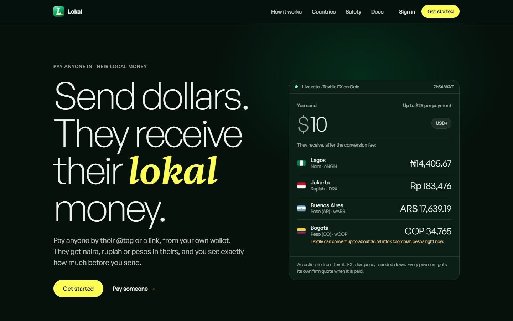
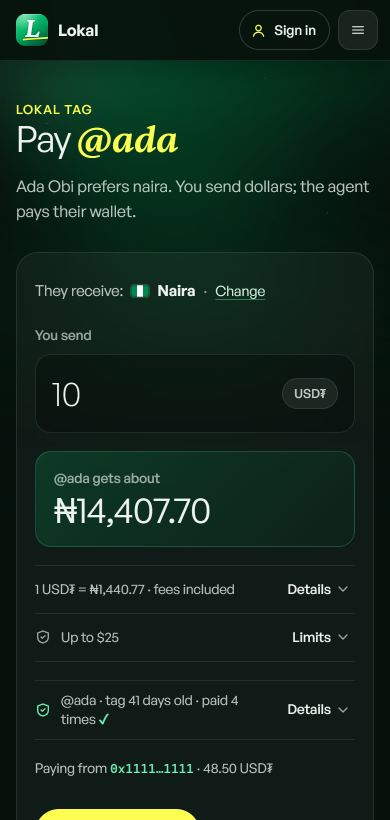
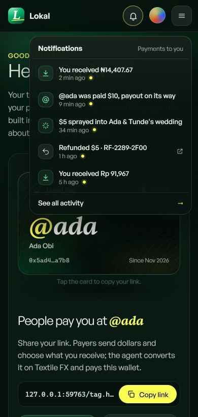
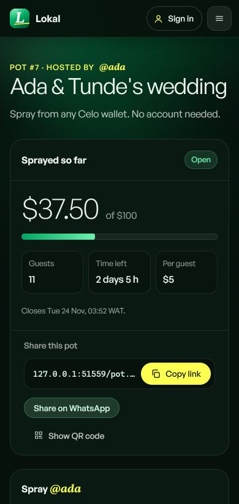

# LokalPay

Send dollars. They receive their local money.

[](https://github.com/deeeko/lokal/actions/workflows/ci.yml)
[](https://github.com/deeeko/lokal/actions/workflows/contracts.yml)
[](LICENSE)

Pay someone's @tag or link from your own wallet on Celo. An agent converts the dollars (USD₮) on Textile FX and pays
naira, rupiah or pesos into their own wallet. Two contracts refuse any payment over a limit before money moves.



**[Live app](https://lokalpay.vercel.app)** ·
Demo video (coming soon) ·
[Proof page](https://lokalpay.vercel.app/proof.html) ·
[LokalTags](https://celoscan.io/address/0xFF2f8ADC0c97B6E40b201848d378C11325bC7187) ·
[LokalPots](https://celoscan.io/address/0x60F76b5d1dc6a9B1e208fB93f6C0B05De51a7DAF) ·
[ERC-8004 #10079](https://celoscan.io/token/0x8004A169FB4a3325136EB29fA0ceB6D2e539a432?a=10079)

Built for **Agents Open for Business** on Celo, **Track 3: Stablecoin Corridors (Textile FX)**. Celo mainnet only.

| Pay a tag | Your dashboard and the bell | A pot's page |
|---|---|---|
|  |  |  |

## Try it in 60 seconds

1. Open **[lokalpay.vercel.app](https://lokalpay.vercel.app)** and type an amount into the converter: you see what
   someone gets in naira, rupiah and pesos at Textile FX's live rate.
2. Press **Get started**, connect a Celo wallet (MetaMask or MiniPay), sign a free message and claim your **@tag**.
   No email, no password: your wallet is your account.
3. Open any tag's page, e.g. `lokalpay.vercel.app/@deekamix`. Choose what they receive, see the exact amount and
   "Who am I paying?", and pay $1 to $25 USD₮ with one signature.
4. Check the **[Proof page](https://lokalpay.vercel.app/proof.html)** and the receipt: every payout is read live from
   Celo, with both transactions and the attribution tag.

## What you can do

- **Pay a LokalPay tag** (`/@name`): the payer picks naira, rupiah, Argentine or Colombian pesos, or dollars.
- **Get paid by link:** ask for an exact amount; share it, with a QR code when you need one. One link, one payout.
- **Pots:** one link for many guests (weddings, birthdays, group gifts), with a live Spray Wall; close or delete
  them from your dashboard.
- **A private dashboard:** your tag, money received, your links and pots, and a bell for incoming payments.
- **"Who am I paying?":** the tag's age and history before you pay, with warnings for first-time payees, new tags
  and lookalike names.
- **Receipts, Proof and Verify:** a receipt for every payout, rebuilt from the chain; a public list of every real
  payout; a checker for any transaction's attribution tag.
- **Refunds:** a payment the agent can't pay goes back to the exact wallet it came from, with an RF- receipt.
- **Cash-out guide:** a checked route from each currency to a bank.
- **The `lokal` command:** `lokal send ada 10 --to rupiah` from PowerShell, with an encrypted wallet on your PC (`lokalpay` is the same command).

## What's real, with receipts

Each row links to its proof on Celo. Everything LokalPay does is on the
[Features page](https://lokalpay.vercel.app/features.html); what's next is in [docs/ROADMAP.md](docs/ROADMAP.md).

| What | Status | Receipt |
|---|---|---|
| LokalTags contract (tags and payments), source verified | **Live** | [deploy tx](https://celoscan.io/tx/0x4d4aa9adba3417e9a7017a4c2e45b4cafe2380702e75f6f9350af7ac58af858e) · [Sourcify, exact match](https://repo.sourcify.dev/42220/0xFF2f8ADC0c97B6E40b201848d378C11325bC7187) |
| LokalPots contract (one link, many payers), source verified | **Live** | [deploy tx](https://celoscan.io/tx/0x8e56d2a9e391a54589ab9e72d683d8307355c5f8b8fb2dd697bab62b65c3ebd9) · [Sourcify, exact match](https://repo.sourcify.dev/42220/0x60F76b5d1dc6a9B1e208fB93f6C0B05De51a7DAF) |
| Contract admin handed to a separate wallet (two-step) | **Live** | [accepted tx](https://celoscan.io/tx/0xbee2dd85e15c4fb664397f06e1a0a932214c6c6a65aaa3aa99e599905c2ec3a6) |
| First LokalPay tag claimed through LokalTags | **Live** | [claim tx](https://celoscan.io/tx/0x4ae77beb9f14d14a1c39525e617a0d6cc50fd08fab68d07a2f3106c8f5e0aeec) |
| ERC-8004 identity, agentId 10079, card updated to LokalPay | **Live** | [register tx](https://celoscan.io/tx/0x080d54275f02a722a3b0daa408f02a1af760e29f9e39092a9a48d22b964cf62e) · [card update tx](https://celoscan.io/tx/0x089fcfc3ef04a5ae2fcb4c016f11d37c7955bd4e86bc32fae18eaa1732c1b327) |
| Payouts in naira, rupiah and pesos; tags, links, pots, refunds, "Who am I paying?" | **Built, not yet used on mainnet** | 379 tests and 135 contract tests, run on every push |
| Builder test, 23 Nov: $20 USD₮ paid out as naira, rupiah, Argentine and Colombian pesos (USD₮ → local) | **Live (team test)** | [NP-EF99-2C95](https://lokalpay.vercel.app/receipt.html#NP-EF99-2C95) · [NP-E8A2-959C](https://lokalpay.vercel.app/receipt.html#NP-E8A2-959C) · [NP-6AB5-87F9](https://lokalpay.vercel.app/receipt.html#NP-6AB5-87F9) · [NP-602D-CA67](https://lokalpay.vercel.app/receipt.html#NP-602D-CA67) |
| Builder test, 23 Nov: all four currencies converted back to dollars (local → USD₮) | **Live (team test)** | [NP-F09B-0274](https://lokalpay.vercel.app/receipt.html#NP-F09B-0274) · [NP-1361-7AB3](https://lokalpay.vercel.app/receipt.html#NP-1361-7AB3) · [NP-D80E-D9FD](https://lokalpay.vercel.app/receipt.html#NP-D80E-D9FD) · [NP-E3F0-6491](https://lokalpay.vercel.app/receipt.html#NP-E3F0-6491) |
| **First real user (named): Alvo, Lagos**: a loan repaid to him through LokalPay, $4 as naira (₦5,811.35 cNGN, converted on Textile FX) and $15 in dollars, to his own wallet tag @alvo | **Live** | [NP-B50B-488C](https://lokalpay.vercel.app/receipt.html#NP-B50B-488C) · [NP-FFF1-C937](https://lokalpay.vercel.app/receipt.html#NP-FFF1-C937) |

Every transaction the agent sends, and every one the site asks a wallet to send, ends with the ERC-8021 attribution
tag `celo_7360953d1b53`; [Verify](https://lokalpay.vercel.app/verify.html) checks any transaction for it.

## How a payout works


1. **Pay.** The payer opens `lokalpay.vercel.app/@ada` (or a payment link), picks what Ada receives, sees the estimate
   and signs one call from their own wallet.
2. **The contract checks.** LokalTags refuses a payment over $25, over $25 to one person in a day, from yourself or to
   an unknown tag. Otherwise it moves the dollars straight to the agent in the same transaction and holds nothing.
3. **The agent checks again.** Autopilot reads the `TagPaid` event, re-checks its own caps and the recipient, and
   records the payment before paying, so it is paid exactly once.
4. **Convert.** A firm Textile FX quote, an exact approval and the swap.
5. **Pay and prove.** Ada gets the measured amount in her own wallet, with a receipt anyone can check. A payment the
   agent can't pay can be refunded to the wallet it came from.

Pots work the same way for many payers: one link and QR code for a wedding or a group gift
([details](docs/ARCHITECTURE.md#pots-one-link-many-guests)).

## Currencies

| 🇳🇬 Naira · cNGN | 🇮🇩 Rupiah · IDRX | 🇦🇷 Argentine peso · wARS | 🇨🇴 Colombian peso · wCOP | 💵 Dollars · USD₮ |
|---|---|---|---|---|

The payer picks on every payment; Textile FX prices each one live. The payer can also pay in any local currency and
the recipient gets dollars. Rates, decimals and how the choice travels on
chain: [docs/PROTOCOL.md](docs/PROTOCOL.md#currencies).

## Safety

- **Non-custodial.** You pay from your own wallet. The contracts never hold money, and the agent holds a payment only
  while it converts it.
- **Limits in code.** $25 per payment and $25 per person per day, checked by the contract before money moves; the
  agent adds its own cap of $100 a day.
- **Exactly once.** Every payment is recorded before it is paid, one agent runs at a time, and a refused payment can
  only go back to the wallet that sent it.
- **No surprises on price.** A firm quote at most 3% worse than the preview, exact approvals, and a payout of what the
  swap actually delivered.
- **Separate keys.** The contracts' admin is not the agent; a new payout wallet waits 24 hours in public. Every rule and
  who enforces it: [docs/WHO-ENFORCES-WHAT.md](docs/WHO-ENFORCES-WHAT.md).

## How it fits Track 3

- **Stablecoin corridors on Textile FX.** USD₮ to cNGN, IDRX, wARS and wCOP (and cNGN back to dollars), one firm
  Textile quote per payout, on Celo mainnet. No self-trading, no market making.
- **An agent open for business.** ERC-8004 identity #10079 with ratings from the people it pays, a public autopilot
  status, and the attribution tag on every transaction so its activity can be counted.
- **Built for real people.** Pay by @tag, link or the `lokal` command from MiniPay or MetaMask; recipients get local
  money in their own wallet, and a [cash-out guide](https://lokalpay.vercel.app/cash-out.html) for each currency.

## Why Celo and Textile FX

Celo gives sub-cent fees, fast finality and MiniPay on millions of phones in the countries LokalPay serves. Textile FX
gives firm-quoted liquidity for real local stablecoins on Celo (cNGN, IDRX, wARS and wCOP), so every conversion is
priced up front and settled onchain, and the payer sees the exact amount before signing.

**Built with:** Solidity 0.8.30 + OpenZeppelin 5 · Hardhat + TypeScript · Node.js + viem · plain HTML, CSS and ES
modules (no framework) · Vercel · Textile FX RFQ · ERC-8004 (identity and ratings) · ERC-8021 (attribution).

## Run it

Node.js 20 or newer.

```powershell
git clone https://github.com/deeeko/lokal.git
cd lokal
npm ci
npm test
cd contracts && npm ci && npm run demo
```

The demo deploys both contracts on a local chain and plays out 28 payments, every outcome asserted
([the table](docs/CONTRACTS.md)). `node scripts/serve.mjs` previews the site; the agent's commands are in
[docs/CLI.md](docs/CLI.md).

## Docs

- [ARCHITECTURE.md](docs/ARCHITECTURE.md): the site, tags, pots, a payout end to end, limits, the code map, the deploy gate, tests
- [CONTRACTS.md](docs/CONTRACTS.md): LokalTags and LokalPots, the 28-step demo, addresses and admin
- [PROTOCOL.md](docs/PROTOCOL.md): currencies, LokalPay tag rules and the cutover, payment links, contract payments; the wire specs [NTAGS.md](docs/spec/NTAGS.md) and [REGISTRATIONS.md](docs/spec/REGISTRATIONS.md)
- [CLI.md](docs/CLI.md): the `lokal` command, the agent CLI, every flag and environment variable
- [OPERATOR.md](docs/OPERATOR.md): running the agent: status server, refunds, the lock, alerts, `doctor`
- [RUNBOOK.md](docs/RUNBOOK.md): the first real payout, step by step
- [WHO-ENFORCES-WHAT.md](docs/WHO-ENFORCES-WHAT.md), [REFUNDS.md](docs/REFUNDS.md), [CASH-OUT.md](docs/CASH-OUT.md)
- [ROADMAP.md](docs/ROADMAP.md) (status, roadmap, business model) and [CHANGELOG.md](docs/CHANGELOG.md)
- [SECURITY.md](SECURITY.md): reporting a vulnerability

## License

MIT
