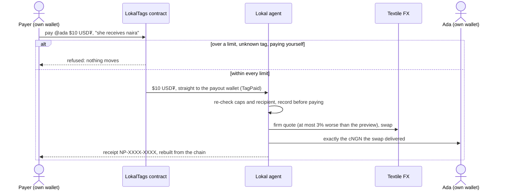

# Lokal

Send dollars. They receive their local money.

[](https://github.com/deeeko/lokal/actions/workflows/ci.yml)
[](https://github.com/deeeko/lokal/actions/workflows/contracts.yml)
[](LICENSE)

Pay someone's @tag or link from your own wallet on Celo. An agent converts the dollars (USD₮) on Textile FX and pays
naira, rupiah or pesos into their own wallet. Two contracts refuse any payment over a limit before money moves.


**[Live app](https://lokalpay.vercel.app)** ·
Demo video (coming soon) ·
[Proof page](https://lokalpay.vercel.app/proof.html) ·
[LokalTags](https://celoscan.io/address/0xFF2f8ADC0c97B6E40b201848d378C11325bC7187) ·
[LokalPots](https://celoscan.io/address/0x60F76b5d1dc6a9B1e208fB93f6C0B05De51a7DAF) ·
[ERC-8004 #10079](https://celoscan.io/token/0x8004A169FB4a3325136EB29fA0ceB6D2e539a432?a=10079)

Built for **Agents Open for Business** on Celo, **Track 3: Stablecoin Corridors (Textile FX)**. Celo mainnet only.

## What's real, with receipts

Each row links to its proof on Celo. Everything Lokal does is on the
[Features page](https://lokalpay.vercel.app/features.html); what's next is in [docs/ROADMAP.md](docs/ROADMAP.md).

| What | Status | Receipt |
|---|---|---|
| LokalTags contract (tags and payments), source verified | **Live** | [deploy tx](https://celoscan.io/tx/0x4d4aa9adba3417e9a7017a4c2e45b4cafe2380702e75f6f9350af7ac58af858e) · [Sourcify, exact match](https://repo.sourcify.dev/42220/0xFF2f8ADC0c97B6E40b201848d378C11325bC7187) |
| LokalPots contract (one link, many payers), source verified | **Live** | [deploy tx](https://celoscan.io/tx/0x8e56d2a9e391a54589ab9e72d683d8307355c5f8b8fb2dd697bab62b65c3ebd9) · [Sourcify, exact match](https://repo.sourcify.dev/42220/0x60F76b5d1dc6a9B1e208fB93f6C0B05De51a7DAF) |
| Contract admin handed to a separate wallet (two-step) | **Live** | [accepted tx](https://celoscan.io/tx/0xbee2dd85e15c4fb664397f06e1a0a932214c6c6a65aaa3aa99e599905c2ec3a6) |
| First Lokal tag claimed through LokalTags | **Live** | [claim tx](https://celoscan.io/tx/0x4ae77beb9f14d14a1c39525e617a0d6cc50fd08fab68d07a2f3106c8f5e0aeec) |
| ERC-8004 identity, agentId 10079, card updated to Lokal | **Live** | [register tx](https://celoscan.io/tx/0x080d54275f02a722a3b0daa408f02a1af760e29f9e39092a9a48d22b964cf62e) · [card update tx](https://celoscan.io/tx/0x30d6545ebb388ce73111eb05cb9c7e49ac6ae55f620e9140561bcf68a1e9f966) |
| Payouts in naira, rupiah and pesos; tags, links, pots, refunds, "Who am I paying?" | **Built, not yet used on mainnet** | 335 tests and 135 contract tests, run on every push |
| First real user payout | **Pending** | It will be listed here and on the [Proof page](https://lokalpay.vercel.app/proof.html) with its transactions |

Every transaction the agent sends, and every one the site asks a wallet to send, ends with the ERC-8021 attribution
tag `celo_7360953d1b53`; [Verify](https://lokalpay.vercel.app/verify.html) checks any transaction for it.

## How a payout works



1. **Pay.** The payer opens `lokalpay.vercel.app/@ada` (or a payment link), picks what Ada receives, sees the estimate
   and signs one call from their own wallet.
2. **The contract checks.** LokalTags refuses a payment over $25, over $25 to one person in a day, from yourself or to
   an unknown tag. Otherwise it moves the dollars straight to the agent in the same transaction and holds nothing.
3. **The agent checks again.** Autopilot reads the `TagPaid` event, re-checks its own caps and the recipient, and
   records the payment before paying, so it is paid exactly once.
4. **Convert.** A firm Textile FX quote, an exact approval and the swap.
5. **Pay and prove.** Ada gets the measured amount in her own wallet, with a receipt anyone can check. A payment the
   agent can't pay can be refunded to the wallet it came from.

Pots work the same way for many payers: one link and QR code for a wedding or a group gift
([details](docs/ARCHITECTURE.md#pots-one-link-many-guests)).

## Currencies

| 🇳🇬 Naira · cNGN | 🇮🇩 Rupiah · IDRX | 🇦🇷 Argentine peso · wARS | 🇨🇴 Colombian peso · wCOP | 💵 Dollars · USD₮ |
|---|---|---|---|---|

The payer picks on every payment; Textile FX prices each one live. Rates, decimals and how the choice travels on
chain: [docs/PROTOCOL.md](docs/PROTOCOL.md#currencies).

## Safety

- **Non-custodial.** You pay from your own wallet. The contracts never hold money, and the agent holds a payment only
  while it converts it.
- **Limits in code.** $25 per payment and $25 per person per day, checked by the contract before money moves; the
  agent adds its own cap of $100 a day.
- **Exactly once.** Every payment is recorded before it is paid, one agent runs at a time, and a refused payment can
  only go back to the wallet that sent it.
- **No surprises on price.** A firm quote at most 3% worse than the preview, exact approvals, and a payout of what the
  swap actually delivered.
- **Separate keys.** The contracts' admin is not the agent; a new payout wallet waits 24 hours in public. Every rule and
  who enforces it: [docs/WHO-ENFORCES-WHAT.md](docs/WHO-ENFORCES-WHAT.md).

## How it fits Track 3

- **Stablecoin corridors on Textile FX.** USD₮ to cNGN, IDRX, wARS and wCOP (and cNGN back to dollars), one firm
  Textile quote per payout, on Celo mainnet. No self-trading, no market making.
- **An agent open for business.** ERC-8004 identity #10079 with ratings from the people it pays, a public autopilot
  status, and the attribution tag on every transaction so its activity can be counted.
- **Built for real people.** Pay by @tag, link or the `lokal` command from MiniPay or MetaMask; recipients get local
  money in their own wallet, and a [cash-out guide](https://lokalpay.vercel.app/cash-out.html) for each currency.

## Run it

Node.js 20 or newer.

```powershell
git clone https://github.com/deeeko/lokal.git
cd lokal
npm ci
npm test
cd contracts && npm ci && npm run demo
```

The demo deploys both contracts on a local chain and plays out 28 payments, every outcome asserted
([the table](docs/CONTRACTS.md)). `node scripts/serve.mjs` previews the site; the agent's commands are in
[docs/CLI.md](docs/CLI.md).

## Docs

- [ARCHITECTURE.md](docs/ARCHITECTURE.md): the site, tags, pots, a payout end to end, limits, the code map, the deploy gate, tests
- [CONTRACTS.md](docs/CONTRACTS.md): LokalTags and LokalPots, the 28-step demo, addresses and admin
- [PROTOCOL.md](docs/PROTOCOL.md): currencies, Lokal tag rules and the cutover, payment links, contract payments; the wire specs [NTAGS.md](docs/spec/NTAGS.md) and [REGISTRATIONS.md](docs/spec/REGISTRATIONS.md)
- [CLI.md](docs/CLI.md): the `lokal` command, the agent CLI, every flag and environment variable
- [OPERATOR.md](docs/OPERATOR.md): running the agent: status server, refunds, the lock, alerts, `doctor`
- [RUNBOOK.md](docs/RUNBOOK.md): the first real payout, step by step
- [WHO-ENFORCES-WHAT.md](docs/WHO-ENFORCES-WHAT.md), [REFUNDS.md](docs/REFUNDS.md), [CASH-OUT.md](docs/CASH-OUT.md)
- [ROADMAP.md](docs/ROADMAP.md) (status, roadmap, business model) and [CHANGELOG.md](docs/CHANGELOG.md)
- [SECURITY.md](SECURITY.md): reporting a vulnerability

## License

MIT
