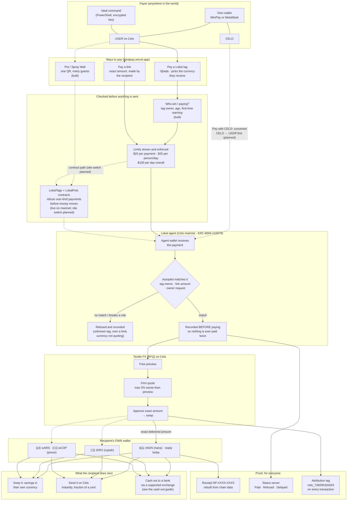
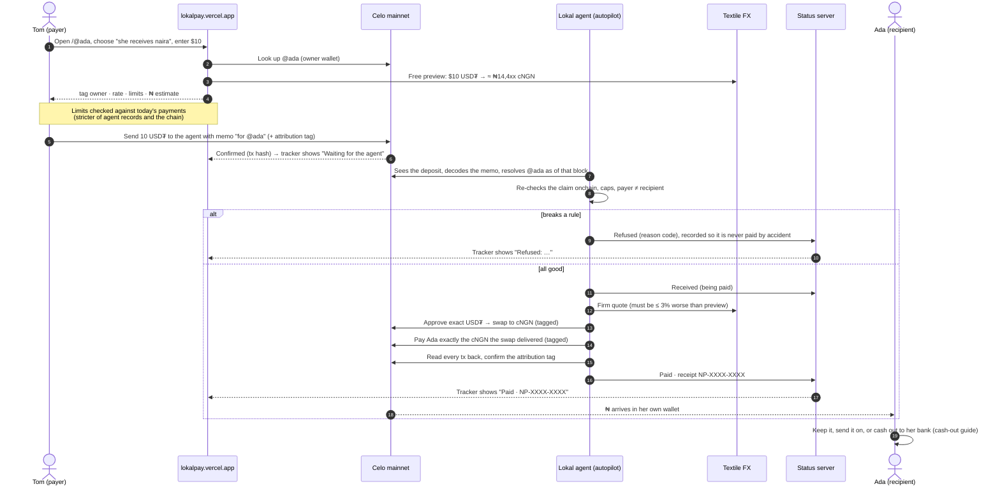

# Architecture: how Lokal is built

How the site, the agent and the contracts fit together, and how a payment becomes a payout. The contracts have their
own page ([CONTRACTS.md](CONTRACTS.md)), as do the formats on the wire ([PROTOCOL.md](PROTOCOL.md)), the command
lines ([CLI.md](CLI.md)) and running the agent ([OPERATOR.md](OPERATOR.md)).

- [What it is and who it's for](#what-it-is-and-who-its-for)
- [Addresses on Celo mainnet](#addresses-on-celo-mainnet)
- [How people use it](#how-people-use-it)
- [The whole journey, end to end](#the-whole-journey-end-to-end)
- [How a payout works](#how-a-payout-works)
- [Safety and limits, enforced in code](#safety-and-limits-enforced-in-code)
- [Code map](#code-map) and the [deploy gate](#deploy-gate)
- [Tests](#tests)

Formerly Naira Payout.

Send dollars, they receive their local money: an agent on Celo that converts USD₮ to a local stablecoin on Textile FX
and pays the recipient's own wallet, by Lokal tag, payment link or command line, with every limit enforced in code.

Multi-currency by design: the payer chooses what the recipient gets, **naira** (cNGN, Nigeria), **rupiah** (IDRX,
Indonesia) or **pesos** (wARS, Argentina; wCOP, Colombia), and the agent pays out in that currency through the same
safety path. All four are built and tested; none has had a real mainnet payout yet. See [Currencies](PROTOCOL.md#currencies).

## What it is and who it's for

Someone abroad wants to send money home. They hold dollars (USD₮) on Celo; the recipient wants their local money.
Lokal's agent sits in the middle: it takes the dollars, converts them to a local stablecoin on **Textile FX**, and pays
the recipient's own Celo wallet. It is built for families and freelancers across **Nigeria, Indonesia, Argentina and
Colombia**: @ada can receive naira; @budi will receive rupiah once the rupiah payouts ship (see
[Currencies](PROTOCOL.md#currencies)).

The agent pays out end to end in **cNGN** (naira), **IDRX** (rupiah), **wARS** and **wCOP** (pesos). The naira corridor also runs the other way
(naira in, dollars out), and the operator can pay out in naira from the agent's CELO. The corridors below are the ones
the agent runs.

- **Senders** pay from any Celo wallet: to a **Lokal tag** (a short handle), through a **payment link**, from the site,
  or from the **`lokal` command line** in PowerShell.
- **Recipients** get paid straight into their own wallet. They can claim a Lokal tag and share `lokalpay.vercel.app/@name`,
  or publish a payment link from their own wallet ("Get paid").
- **The operator** runs the agent (`src/agent.mjs`): it watches for deposits (`watch --execute`) and pays them out,
  under hard limits.

The site is **non-custodial**: it never holds keys or money. Every payment a page asks for is sent from the user's own
wallet. The agent holds only what it is converting at that moment.

| Corridor | Payer sends | Recipient gets | Amount typed in | Used by |
|---|---|---|---|---|
| `usdt-cngn` (default) | USD₮ | cNGN | USD₮ | Lokal tags, payment links, Get paid, CLI, operator |
| `cngn-usdt` | cNGN | USD₮ | naira (cNGN) | Lokal tags, payment links, Get paid, CLI, operator |
| `usdt-idrx` | USD₮ | IDRX | USD₮ | Lokal tags, payment links, Get paid, CLI, operator |
| `usdt-wars` | USD₮ | wARS | USD₮ | Lokal tags, payment links, Get paid, CLI, operator |
| `usdt-wcop` | USD₮ | wCOP | USD₮ | Lokal tags, payment links, Get paid, CLI, operator |
| `celo-cngn` | CELO (from the agent wallet) | cNGN | CELO | operator `pay` and `quote` only |

## Addresses on Celo mainnet

Chain 42220. The app: [lokalpay.vercel.app](https://lokalpay.vercel.app) (in-app [docs](https://lokalpay.vercel.app/docs.html)),
with a [GitHub Pages mirror](https://deeeko.github.io/lokal/). Built for the **Agents Open for Business**
hackathon on Celo, **Track 3: Stablecoin Corridors (Textile FX)** (deadline 7 Dec 2026).

| | |
|---|---|
| Agent wallet | [`0x8a695cf54CB44753c8b784EB36d266f748617a1e`](https://celoscan.io/address/0x8a695cf54CB44753c8b784EB36d266f748617a1e) |
| ERC-8004 identity | agentId **10079** in the Identity Registry [`0x8004A169FB4a3325136EB29fA0ceB6D2e539a432`](https://celoscan.io/address/0x8004A169FB4a3325136EB29fA0ceB6D2e539a432) |
| ERC-8004 reputation | Reputation Registry [`0x8004BAa17C55a88189AE136b182e5fdA19dE9b63`](https://celoscan.io/address/0x8004BAa17C55a88189AE136b182e5fdA19dE9b63) |
| LokalTags (tags + payments) | [`0xFF2f8ADC0c97B6E40b201848d378C11325bC7187`](https://celoscan.io/address/0xFF2f8ADC0c97B6E40b201848d378C11325bC7187) · source verified on [Sourcify](https://repo.sourcify.dev/42220/0xFF2f8ADC0c97B6E40b201848d378C11325bC7187) (exact match) |
| LokalPots (pots) | [`0x60F76b5d1dc6a9B1e208fB93f6C0B05De51a7DAF`](https://celoscan.io/address/0x60F76b5d1dc6a9B1e208fB93f6C0B05De51a7DAF) · source verified on [Sourcify](https://repo.sourcify.dev/42220/0x60F76b5d1dc6a9B1e208fB93f6C0B05De51a7DAF) (exact match) |
| Attribution tag (ERC-8021) | `celo_7360953d1b53`, on every transaction the agent sends **and** on every transaction the site asks a user's wallet to send (tag claims, payments, registrations, ratings) |
| USD₮ | [`0x48065fbBE25f71C9282ddf5e1cD6D6A887483D5e`](https://celoscan.io/address/0x48065fbBE25f71C9282ddf5e1cD6D6A887483D5e) (6 decimals) |
| cNGN (naira) | [`0xF6829D7393dAe24509eb1E52eE8e572e2E271a4f`](https://celoscan.io/address/0xF6829D7393dAe24509eb1E52eE8e572e2E271a4f) (6 decimals) |
| IDRX (rupiah) | [`0x18Bc5bcC660cf2B9cE3cd51a404aFe1a0cBD3C22`](https://celoscan.io/address/0x18Bc5bcC660cf2B9cE3cd51a404aFe1a0cBD3C22) (2 decimals) |
| wARS (Argentine peso) | [`0x0DC4F92879B7670e5f4e4e6e3c801D229129D90D`](https://celoscan.io/address/0x0DC4F92879B7670e5f4e4e6e3c801D229129D90D) (18 decimals) |
| wCOP (Colombian peso) | [`0x8a1D45e102e886510e891d2Ec656a708991e2D76`](https://celoscan.io/address/0x8a1D45e102e886510e891d2Ec656a708991e2D76) (18 decimals) |
| CELO (GoldToken) | [`0x471EcE3750Da237f93B8E339c536989b8978a438`](https://celoscan.io/address/0x471EcE3750Da237f93B8E339c536989b8978a438) (18 decimals) |
| Textile LimitOrderReactor | [`0xa9AA0a64769cBed4d3B1Ceb4Df01CdE915C235b3`](https://celoscan.io/address/0xa9AA0a64769cBed4d3B1Ceb4Df01CdE915C235b3) (per the hackathon brief) |

## How people use it

### The website: landing, sign-up, dashboard

The site has three front doors (plus two public pages with the landing's chrome), and what each person sees depends on whether they are signed in on this device.

| Page | Who it is for | What it does |
|---|---|---|
| **Landing** (`/`, `index.html`) | everyone new | Six sections, one job each: the hero with a **live converter** (type $10, see naira, rupiah and both pesos from `/api/rate`), how it works in three lines, the four countries as a live rate board, why it's safe (the two contracts on Celoscan), **Proof** (real payouts read from Celo, with an honest empty state until the first one, and the status in one line), and the last word with four questions. A slim top bar: How it works, Countries, Safety, Proof, Features, Sign in, Get started. |
| **Features** (`features.html`) | anyone who wants the whole list | **Everything Lokal does**: every capability with its honest Live / Built / Planned label and a "try it" link, the Status today box and what's coming next. Same top bar and footer as the landing. |
| **Proof** (`proof.html`) | anyone checking | Every real payout read from Celo ([below](#proof)). Same top bar and footer as the landing. |
| **Sign-up gateway** (`start.html`) | someone who wants to get paid | One calm step at a time with a progress line: **Connect** (the wallet shares its address; nothing signed) → **Sign in** (the free signed message, the same sign-in as before) → **Your tag** (the LokalTags contract answers as you type) → **Your name** (optional), then **one** `claim(tag, name)` transaction, simulated first → **Welcome** (your card, your link and QR, "Add <token> to your wallet", next steps). Signing up and signing in are the same flow: the wallet is the account, with no email or password. No currency is asked for. |
| **Dashboard** (`app.html`) | the signed-in wallet | Your tag card and link (copy, WhatsApp, QR), quick actions (create a payment link, send money), **money received** (payouts to this wallet, per currency), **recent payments** (only yours), **your payment links** with their status, **Add to your wallet** for cNGN, IDRX, wARS, wCOP and USD₮ (`wallet_watchAsset`, after switching the wallet to Celo), and **settings**: display name (`setName`), default currency (`setReceiveToken`, optional) and release, each simulated before the wallet opens. |

**Signed in on this device, `/` opens the dashboard.** `site/assets/gate.js` runs in the landing's `<head>` (a plain
script, allowed by `script-src 'self'`), reads the saved sign-in and sends the browser to `app.html` before anything is
drawn. `index.html?about` ("About Lokal", in every page's footer and the account menu) always shows the landing. The
dashboard never sends anyone back: signed out (or with the wallet locked) it shows a sign-in panel, so the two pages
can't bounce between each other.

**Public vs signed in.**

- **Public, no account needed** (payers must be able to pay in seconds): a tag's pay page (`/@tag`, `tag.html`), a pot's
  page (`pot.html`), payment links (`pay.html`), quotes, receipts, verify, the cash-out guide, docs, privacy, terms, the
  agent page, autopilot, Features and Proof.
- **Signed in only:** the dashboard, and **Activity** (`transactions.html`), which now shows only your own payments
  ("Yours"). Visitors see a sign-in prompt there instead: the agent's full feed and other people's addresses are not
  shown to them. The autopilot board stays public for its timings but no longer prints anyone's wallet address. (The
  chain itself is public; this site just doesn't put other people's payments in front of visitors.)

**Navigation.** App pages share one sidebar: Dashboard · Send · Get paid · Activity · Account · Docs (Activity groups
Your activity, Receipts, Verify, Agent and Autopilot; Docs groups Docs, Cash out, Privacy and Terms).
`scripts/check-site.mjs` keeps that chrome identical on every app page (`app.html` is the reference;
`node scripts/sync-chrome.mjs` copies it) and deliberately lets the landing, the gateway, Proof and Features have their own slim chrome,
checked by their own rules (Proof and Features must carry the landing's footer links, and the landing must link both). Below 1100 px the app top bar is a full-width bar whose height is reserved, so it never sits
on top of page content.

**Design.** A deeper, calmer green ground (`#06110c`, raised `#0a1a12`, frames `#0c1f16`), text that clears WCAG AA,
and Celo yellow (`#fcff52`) only for the one filled action, the cursive *lokal* and the arrows of text links. General
Sans Light for big display lines (tight tracking), General Sans for body (no tracking), Sentient Italic for the one
accent word, a system mono for addresses and code. Motion is calm (about 0.4 s, transform and opacity, no bounce),
pressing anything scales it to 0.97 in 100 ms, the landing's sticky bar is the only glass, and
`prefers-reduced-motion` (cross-fades only), `prefers-reduced-transparency` (solid panels) and `prefers-contrast: more`
(stronger lines) are honoured. No framework, no CDN, self-hosted fonts.

Every payment screen shows the limits: **$25 per payment, $25 per person per day, $100 per day overall**.

### Lokal tags: get paid at @yourname

A Lokal tag is a handle like `@ada` tied to one Celo wallet. People pay the tag; the agent pays the wallet that holds it.

1. **Sign in with your wallet** (`account.html`). Connect a wallet and sign a short sign-in message (EIP-4361 style,
   via `personal_sign`). It is free, sends nothing, and needs no password. The session (address, message, signature,
   expiry; 7 days) is kept in your browser under `np-session`. Signing out deletes it and disconnects the wallet.
   On Vercel the signature is checked by `POST /api/session` (see [Safety](#safety-and-limits-enforced-in-code)).
2. **Your name.** The setup guide (Sign in → Your name → Claim your Lokal tag → Done) asks for an optional display name
   (1–40 characters).
3. **Claim your @tag.** Type a tag; the **LokalTags contract** answers as you type (`availability`: free, yours,
   taken, reserved, locked or invalid, with the exact rule broken), with suggestions when it is taken and a live
   preview of your tag card. You confirm that tags and names are **public and permanent**, the page simulates the call
   (`eth_call`) so any refusal is explained before your wallet opens, then your wallet sends one call to LokalTags:
   `claim("ada", "Ada Obi")` plus the attribution suffix. The page reads the tag back from the contract over RPC, so
   there is no waiting for an explorer: if someone claimed it a moment earlier, the contract refuses yours and the
   page says so.
4. **Share** `https://lokalpay.vercel.app/@ada` (on the GitHub Pages mirror: `tag.html#ada`), with a QR code and a
   WhatsApp button. The account page also shows your wallet balances (USD₮, the local stablecoin, CELO; today cNGN) and the payments to your tag
   with receipt links (paid, refused, or **Refunded · RF-XXXX-XXXX**). From the same page you can rename the tag
   (`setName`, or clear the name), set an optional **default currency** (`setReceiveToken`: what your pay page
   pre-selects; payers can still choose), switch to another tag (`claim` releases the old one) or release it
   (`release`). Each is one contract call from your own wallet, simulated first.

**Paying a tag** (`tag.html`, or `/@ada` on Vercel): the public tag page reads the holder, name, "since" date and
default currency from LokalTags over RPC. The payer picks what the owner receives on this payment: **naira, rupiah,
Argentine peso or Colombian peso** (send USD₮), or **dollars** (send cNGN); the owner's default, if set, is
pre-selected. They type an amount and see a live estimate, how much more the owner can receive from the agent today,
and the **contract's room today** (`remainingToday`: per recipient, per payer and overall, capped at the per-payment
maximum). Before the wallet opens the page re-reads the tag, runs the contract's own dry run
(`validatePayment`) and simulates the exact call from the payer's wallet, so a refusal (`OverPaymentLimit`,
`OverRecipientDailyLimit`, `OverPayerDailyLimit`, `SelfPayment`, `TagNotFound`, `Paused`, ...) is shown in plain
English and nothing is sent. Then:

```
USD₮:  sign one EIP-2612 permit (exactly the amount, 30 minutes)  ->  payTagWithPermit(tag, USD₮, amount, ref, agent, deadline, v, r, s)
cNGN:  approve(LokalTags, exactly the amount)                     ->  payTag(tag, cNGN, amount, ref, agent)
       ref = "cur:<code>" (what the owner receives), agent = the payout wallet the payer pins; + attribution suffix
```

The contract checks every limit and moves the tokens from the payer straight to the agent in the same transaction;
wallets see a normal contract call instead of the memo transfer that triggered MetaMask's red warnings. After sending,
the page tracks the payment live: confirmed on Celo, then the agent's payout to the owner, ending in **"Paid ·
NP-XXXX-XXXX"** with a receipt link (or, if the agent refuses it, "Not paid: <reason>. Your money is safe with the
agent and can be sent back to the wallet you paid from", and later **"Refunded · RF-XXXX-XXXX"**). Tracking survives a
page reload. A tag claimed with the older memo protocol before the cutover (and not held on the contract) is still
paid the old way: one ERC-20 transfer to the agent with `hex("NTP:" + tag)` after the standard 68 bytes, plus the
attribution suffix (see [Lokal tag rules](PROTOCOL.md#lokal-tag-rules)).

### Pots: one link, many guests

A pot is one link and QR code that many guests pay into: a wedding where guests "spray" the couple, a birthday, a
group gift. Built, not yet used on mainnet.

- **Open one** on the dashboard ("Your pots"), from a wallet that holds a tag: a title, when it closes (up to 14 days)
  and two caps read live from LokalPots (up to $100 a pot, $5 a guest). The page simulates `createPot` first and shows
  the link (`pot.html?id=N`) and QR code. The host can `closePot` early from the same card.
- **Spray** (`pot.html?id=N`, public, no account): connect a wallet, pick an amount in USD₮ or cNGN, choose what the
  host receives. The contract's dry run (`validatePotPayment`) explains any refusal first; then an exact `approve`
  for LokalPots (it has no permit) and `payPot(id, token, amount, "cur:<code>", payout wallet)`, both attribution-tagged.
- **The Spray Wall** shows the pot's `PotPaid` events (explorer log API, else `eth_getLogs` on Forno, polled every
  15 s): amounts and times, never who paid. A new spray drops onto the wall; with reduced motion it fades in.
- Autopilot already pays `PotPaid` in the guest's chosen currency ([how](PROTOCOL.md#payments-through-the-contracts-tagpaid-potpaid)).

### Payment links and paying a link

"Get paid" links and how a payer pays one: see [PROTOCOL.md](PROTOCOL.md#payment-links-get-paid).

### Quotes ("Send")

`quote.html` gives a free live Textile FX price for every corridor: USD₮ → naira, rupiah, Argentine or Colombian
pesos (pick one under "They receive"), naira → USD₮, and "From CELO" (a two-swap estimate, operator-only). The rate comes from `/api/rate` (Textile, cached for 60 s at
the edge), with a static `rate.json` fallback refreshed every 30 minutes.

### Activity, receipts and reviews

- **Your activity** (`transactions.html`): signed in, your wallet's own payments with Lokal: what you sent (tag
  payments through LokalTags or older memos, link payments), what the agent paid you, and your tag and payment-link
  transactions, each with its attribution tag and receipt; CSV export. Visitors see a sign-in prompt instead (the
  agent's full feed is not shown on the site any more; it stays public on Celoscan).
- **Receipts** (`receipt.html`): every executed payout gets a number `NP-` + the first 8 hex characters of the payout
  transaction hash, upper-case (for example `NP-7F3A-91C2`), so anyone can work it out from the chain. The receipt page
  finds a payout by number or hash and rebuilds it from Celo in the browser: payout, swap, effective rate and each
  transaction's tag. It can be saved as an image or PDF, shared on WhatsApp or as a QR code.
- **Reviews**: from a receipt, the payer can rate the payout 1–5 stars with a `giveFeedback` transaction to the ERC-8004
  Reputation Registry, sent **from their own wallet**. The registry rejects ratings from the agent's owner or operators.
  The Agent page lists the ratings; "Verified payer" is our own check that the reviewer has sent USD₮ or a local
  stablecoin (today cNGN) to the agent, since the registry cannot check that.
- **Verify** (`verify.html`): paste any Celo transaction hash to see its attribution tag.

### "Who am I paying?"

Every tag page shows, before paying: the tag's age, payments received through LokalTags (never who paid) and the
owner (address, copy, Celoscan; the name is "set by the owner, not checked by anyone"). One-line warnings appear only
when they apply, and none blocks payment: **first-time payee** (this browser's list of paid tags, kept only with the
privacy consent), **new tag** (24 h), **changed hands** (30 days), **lookalike** (one edit from a tag you paid, or a
reserved name) and **name changed** (7 days). History comes from `eth_getLogs` by tag hash (Blockscout, else Forno in
5,000-block chunks); a failed read says "Couldn't check". Code: `site/assets/trust.js`.

### Proof

`proof.html` lists every real payout, read live from Celo: date, corridor, amounts, receipt, deposit and payout
transactions, and a check that `celo_7360953d1b53` is in the payout's input. Totals: payouts, USD converted,
currencies, people paid (a count; no address is ever shown). Consented named users go in `site/proof-users.json`
(empty); an entry whose receipt isn't a real payout shows in red. Until the first payout it says "No real payouts yet".

### Pay from CELO, and the `lokal` command line

Both are in [CLI.md](CLI.md): [pay from CELO](CLI.md#pay-from-celo-operator) and
[the `lokal` command line](CLI.md#the-lokal-command-line-powershell).

## The whole journey, end to end

### 1. Every path money can take

How dollars (or CELO) sent from anywhere become naira, rupiah or pesos in someone's own wallet, what is checked on the
way, and what the recipient can do next. Solid arrows are live today; dashed arrows are being rolled out (marked in
the labels).



### 2. One payment, step by step

Ada (in Lagos) has claimed `@ada` and prefers naira. Tom (in London) pays her $10 from his own wallet.



## How a payout works

**One payout** (`pay` in `src/pay.mjs`), the same for both stablecoin corridors and for every way of paying:

1. **Preview.** Checks the recipient (allow-listed contact, or a wallet that passes the recipient rules) and the caps,
   and gets a free Textile FX preview. A dry run stops here.
2. **Firm quote.** With `--execute`: checks both tokens report 6 decimals (true of USD₮ and cNGN; IDRX uses 2 and the
   pesos 18, which the per-currency payouts will handle), the wallet holds the amount and about 0.02
   CELO, asks the operator to type `yes` (autopilot passes this), then gets a firm quote and checks it against the
   preview: at most **3% worse** and never asking for more than the amount.
3. **Swap.** Approves exactly what the quote needs on the sold token, to a contract the agent builds itself (not taken
   from the quote), resetting an old allowance first. Broadcasts Textile's swap. An expired quote is never sent.
4. **Pay the exact delivered amount.** Pays the recipient the *measured* balance change of the bought token, capped at
   what the swap itself delivered, never an assumed amount.
5. **Verify the tag on every transaction.** Reads every transaction back from the chain and flags any missing the
   attribution tag (the run exits non-zero), logs the payout to `receipts.jsonl` and prints the receipt number and link:

   ```
   Receipt NP-7F3A-91C2: https://lokalpay.vercel.app/receipt.html#NP-7F3A-91C2
   ```

Every transaction the agent sends (reset, approval, swap, payout, identity registration) carries `celo_7360953d1b53`,
attached once where the wallet client is built (`src/chain.mjs`) with `@celo/attribution-tags`.

### Autopilot (`watch --execute`)

`watch` reads ERC-20 Transfer events to the agent on USD₮ and cNGN (Forno `eth_getLogs`, at most 5000 blocks per
query) and decides what each deposit is for. It scans only up to the block Blockscout has indexed, so a fresh
registration or tag claim is never missed. Its block cursor is saved in `watch-state.json`, so after a restart it picks
up deposits that arrived while it was off. RPC errors back off up to 5 minutes; Ctrl+C stops cleanly between steps.

| Deposit | Matched when | Pays |
|---|---|---|
| **Lokal tag payment** | the transfer calldata carries a valid `NTP:<tag>` memo | the wallet that held the tag just before the deposit (by block and position) |
| **Operator request** (`request`) | sell token, **exact** amount, after creation and before expiry | the allow-listed contact |
| **"Get paid" registration** | the **active** registration for that token and exact amount, at the deposit's block time | the registration's sender |

Rules that hold for all three:

- **Memo payments are never amount-matched.** A deposit with a Lokal tag memo is never matched against requests or
  registrations, and neither is anything that merely *looks like* a Lokal tag attempt (the `NTP:` bytes anywhere in the
  input, also inside a smart-wallet call, or a transfer with unexplained extra bytes). Those are refused unless the memo
  decodes cleanly on a direct transfer.
- **Checks first, then record, then pay.** Before anything is recorded, the claim or registration is **re-read over
  RPC** (success, sent to the agent, same sender, block, position, block time, content, zero value), and the recipient
  rules, caps and a live preview run. The deposit is then **recorded before paying** (`requests.json`,
  `registrations-state.json` or `ntag-payments.json`), so a crash can never pay it twice.
- **Refusals are recorded.** Self-payment, a blocked recipient, an unknown tag, a Lokal tag payment under $1, a claim or registration that does not
  check out, or a per-payment / per-wallet cap (also when only the firm quote breaks it) is logged as
  `refused_deposit` and recorded as handled, so a rescan never pays it. The money stays in the agent wallet; for Lokal tag
  payments the operator can pay one later by hand with `retry --ntag <tx>:<logIndex> --force-refused` (every cap
  applies again).
- **Stops instead of guessing.** The global daily cap or a missing price stops autopilot *without* recording anything,
  with the cursor pinned before the deposit, so it matches again once the cause is fixed. A payout error is saved and
  autopilot stops; `retry` finishes it, and refuses once a swap or payout transaction was sent.
- **Exactly once, even when a write fails.** A deposit counts as handled only once its handling finished, writes
  included. If the "paid" record cannot be saved after a payout, autopilot stops and says the deposit **was** paid, so
  it is never retried.
- **Ambiguous or unmatched deposits are never paid.** A deposit matching both an operator request and a registration
  is logged as `ambiguous_deposit`. Unmatched deposits are logged. The agent's own swap output is ignored.
- Without `--execute`, `watch` prints what it would do and writes nothing.

Operator requests add a random 0.01–0.99 to the amount so it is unique among open requests (and still within the
per-payment cap), and avoid the amounts of active "Get paid" links.

Payments through the contracts (`TagPaid`, `PotPaid`) are described in
[PROTOCOL.md](PROTOCOL.md#payments-through-the-contracts-tagpaid-potpaid). The status server, refunds, the agent lock,
alerts and `doctor` are in [OPERATOR.md](OPERATOR.md).

## Safety and limits, enforced in code

All numbers are defaults from `src/config.mjs`; the language-parsing layer of `ask` never decides any of them.

| Rule | Value | Where |
|---|---|---|
| Per payment | **$25** (`MAX_USD`) | `src/guards.mjs`, `src/pay.mjs` |
| Per recipient wallet, rolling 24 h | **$25** (`MAX_WALLET_DAILY_USD`; Get paid and Lokal tag payouts) | `src/guards.mjs`, `src/pay.mjs` |
| Everything the agent pays, rolling 24 h | **$100** (`MAX_DAILY_USD`, counted from `receipts.jsonl`) | `src/guards.mjs` |
| Firm quote vs. preview | at most **3%** worse (`MAX_SLIPPAGE_BPS` = 300), per swap | `src/guards.mjs`, `src/pay.mjs` |
| `cngn-usdt` cap | checked on the preview, the firm quote and the amount actually paid | `src/pay.mjs` |
| CELO reserve | `celo-cngn` keeps **2 CELO** + **0.1 CELO** gas margin; refused below **1.05 USD₮** from swap 1 | `src/guards.mjs`, `src/celo.mjs` |
| Blocked recipients | the agent, the operator's `own_wallets`, the USD₮, cNGN and CELO token contracts, both ERC-8004 registries, the zero address, and the payer | `src/guards.mjs`, `src/pay.mjs` |
| Dry run by default | real money moves only with `--execute`; a manual payout also needs you to type `yes` (or `--yes`) | `src/pay.mjs` |
| Exact approvals | only what each firm quote needs, old allowance reset first; expired quotes never sent | `src/pay.mjs`, `src/celo.mjs` |
| Measured payout | the bought token's balance change, capped at what the swap delivered | `src/pay.mjs`, `src/celo.mjs` |
| Agent key never printed | kept in `~/.celo-naira-agent/agent.json`, outside the repo, git-ignored | `src/chain.mjs` |
| Encrypted CLI wallet | scrypt + AES-256-GCM, send password, 5 wrong in 10 min → 5-minute lockout, refuses the agent's key | `src/ntag.mjs` |
| Non-custodial site | no keys, no funds; every transaction a page asks for is the user's own (claim, payment, registration, rating) | `site/` |
| Stateless sign-in check | `POST /api/session`: JSON only, at most 4 KB, no cookies, no database, nothing stored or logged | `api/session.js` |
| One agent at a time | `agent.lock` (created with `wx`: pid, host, start time, command) taken by `watch --execute` and every `--execute` command; a live holder is refused; a stale one is never removed without `--clear-stale-lock`; released on exit, Ctrl+C, SIGTERM and crashes | `src/lock.mjs` |
| Refunds | only refused, unmatched (incl. expired or used links) and ambiguous deposits, to the deposit's `from`, same token and amount; never paid, top-up, swap-output or reactor transfers; recorded as `sending` before the transfer; **$100** per rolling 24 h (`MAX_DAILY_REFUND_USD`), nothing under **$1** (`MIN_REFUND_USD`); never counted in the payout caps | `src/refund.mjs`, `src/guards.mjs` |
| Refunded never paid, paid never refunded | autopilot and `retry --force-refused` refuse a deposit with a refund record; `refund` refuses one with a payout record | `src/watch.mjs`, `src/agent.mjs`, `src/refund.mjs` |
| Alerts | autopilot stopped, payout or refund failed (urgent); daily cap, CELO under **3** (`LOW_CELO_WARN`) or the reserve, status server down 10 min (warning); refused, paid (info). Outbox, 5 s timeout, never blocks a payout, no secrets | `src/alerts.mjs`, `src/watch.mjs` |
| Heartbeat | signed, about once a minute, kept apart from the deposit records, replays refused; `GET /api/status?agent=1`; a watchdog alerts after 10 minutes of silence | `src/watch.mjs`, `lib/status.mjs`, `api/status.js` |

**Sign-in check** (`api/session.js`, Vercel only): checks the message is this site's sign-in text, for a known host
(the request's own host, `lokalpay.vercel.app`, or the older `naira-payout.vercel.app` and `celo-naira-payout-agent.vercel.app`), on Celo (chain 42220) and
not expired, and that the address signed it. Normal wallets (EIP-191) are verified locally with viem; smart-contract
wallets (ERC-1271, or ERC-6492 before deployment) are checked on Celo through Forno with an 8-second timeout. Returns
`{ ok, address, exp }`, 400 for a bad sign-in, or 503 if Celo could not be asked in time. On the GitHub Pages mirror and
the local preview there is no server, so the page accepts the signature the wallet returns (stated in the privacy page).

**Other site hardening:** a Content-Security-Policy on every page (`script-src 'self'`, no inline scripts), no
frameworks or CDNs, self-hosted fonts, security headers from `vercel.json`, and a read-only, allow-listed Blockscout
proxy (`/api/explorer`) that can only read public data.

**`ask`** turns "send $10 to ada" into a contact name and an amount with a built-in parser. An optional hosted
language model can handle looser phrasing when its API key is set in the environment (see `src/intent.mjs` and
`.env.example`). Either way it returns only a name and a number; code resolves the name and applies every rule above.
Autopilot never uses it.

## Code map

No framework and no bundler: Node ESM with `viem` and `@celo/attribution-tags` for the agent, and a static site in plain
HTML, CSS and ES modules.

| Path | What it is |
|---|---|
| `src/config.mjs` | addresses, corridors, limits, tag, file paths: everything that touches money |
| `src/guards.mjs` | safety rules: amounts, caps (per payment, per wallet, 24 h), recipients, slippage |
| `src/textile.mjs` | Textile FX RFQ v2 client (previews and firm quotes) |
| `src/pay.mjs` | the payout flow for both stablecoin corridors, preflight checks, blocked recipients |
| `src/celo.mjs` | pay in naira from CELO: two swaps, gas reserve, recovery message |
| `src/requests.mjs` | operator payment requests: unique amounts, link encoding, deposit matching, receipt numbers |
| `src/registrations.mjs` | "Get paid" registrations: decoding, discovery, the same-amount rule (ported from the site) |
| `src/ntags.mjs` | Lokal tags: resolver (byte-identical port of the site's), memo decoding, discovery, onchain claim check, local state |
| `src/watch.mjs` | autopilot: watches deposits and pays requests, registrations and Lokal tag payments |
| `src/ntag.mjs` | the `lokal` CLI (also runs as `ntag`): encrypted wallet, whois, send, claim, release, status |
| `src/agent.mjs` | the operator command line |
| `src/intent.mjs` | plain-language parser for `ask` |
| `src/register8004.mjs` | ERC-8004 registration |
| `src/chain.mjs` | agent wallet and the attribution-tagged client |
| `site/` | the live app: `index` (the landing), `start` (sign-up), `app` (dashboard), `quote`, `pay`, `tag`, `get-paid`, `account`, `transactions`, `receipt`, `verify`, `agent`, `autopilot`, `docs`, `privacy`, `terms`, `404`, and the public `features`, `proof` and `pot` |
| `site/assets/core.js` | shared site code: ABI codec, link formats, registrations, the Lokal tag resolver, explorer and RPC helpers |
| `site/assets/session.js` | wallet sign-in (message, session, Celo network switch, wallet error messages) |
| `site/assets/gate.js` | the landing's front door: a signed-in visitor goes to the dashboard (classic script in `<head>`) |
| `site/assets/front-door.js` | who sees what: Activity and dashboard gating, the gateway's first step, the public pages |
| `site/assets/my-activity.js` | "Yours": one wallet's own payments with Lokal, shared by the dashboard and Activity |
| `site/assets/wallet-assets.js` | "Add <token> to your wallet" (`wallet_watchAsset`) |
| `site/assets/landing.css`, `app.css` | the landing, Features, Proof and gateway styles; the dashboard styles |
| `site/assets/ntag-ui.js`, `ntags.css` | the tag card, claim and pay UI pieces |
| `api/session.js` | stateless sign-in check |
| `api/rate.js` | live Textile rate, edge-cached 60 s, falls back to the static `rate.json` |
| `api/explorer.js` | read-only, allow-listed, cached Blockscout proxy |
| `lib/rate.mjs` | builds the rate (shared by `api/rate.js` and `scripts/fetch-rate.mjs`) |
| `scripts/vercel-build.mjs` | the Vercel deploy gate |
| `scripts/check-site.mjs` | static site checks: links, assets, CSP, page scripts parse, JSON and SVG valid |
| `scripts/fetch-rate.mjs` | writes `site/rate.json` |
| `scripts/serve.mjs` | local preview server (`node scripts/serve.mjs`, port 4173) |
| `scripts/sync-chrome.mjs` | copies the app chrome (sidebar, top bar, footer) from `site/app.html` to every app page |
| `scripts/screenshots.mjs` | screenshots of the landing (whole page and each section), Features, Proof, the gateway steps and the dashboard; `--front` for the first three only (Playwright; mocks only in its own browser) |
| `contracts/` | Solidity contracts (`LokalTags`, `LokalPots`, `LokalText`), Hardhat + TypeScript tests, the one-command demo, the deploy script and ABIs (see [The contract has the final say](CONTRACTS.md#the-contract-has-the-final-say)) |
| `docs/WHO-ENFORCES-WHAT.md` | every rule, and whether the contract, the agent or the site enforces it |
| `test/` | 335 unit and integration tests (`node --test`) |
| `.github/workflows/ci.yml` | tests, a syntax check of every script, and the site check on every push and pull request |
| `.github/workflows/contracts.yml` | compiles and tests the contracts and runs the demo (every row asserted) whenever the contracts or the site's tag rules change |
| `.github/workflows/pages.yml` | GitHub Pages mirror: deploys only after tests and the site check pass; refreshes the rate every 30 min (read-only, no secrets) |

## Deploy gate

Vercel builds with `node scripts/vercel-build.mjs` on every push to `main` (production) and every pull
request (preview). It runs `npm test`, then `node scripts/check-site.mjs`, then refreshes `site/rate.json`. If the tests
or the site check fail, the build exits non-zero and **Vercel does not deploy**. The build also strips internal spec
files from the published site. `vercel.json` adds the `/@:tag` → `tag.html?t=:tag` rewrite, the explorer proxy rewrite,
security headers and cache rules.

## Tests

```powershell
npm test                          # 335 tests, all passing
node scripts/check-site.mjs       # static site check
```

| File | Tests | Covers |
|---|---|---|
| `test/agent.test.mjs` | 8 | amounts and caps, recipient allow-list and blocklist, slippage, the plain-language parser, the Textile request body, the attribution suffix |
| `test/celo.test.mjs` | 11 | the CELO corridor: 1.05 USD₮ minimum, gas reserve, swap 2 sells exactly swap 1's output, recovery command, refused by links and Get paid |
| `test/core-codec.test.mjs` | 7 | the site's codec checked against viem: registrations, receipt numbers, `giveFeedback`, feedback decoding, tag suffix, link tampering |
| `test/payment-links.test.mjs` | 9 | corridors, unique amounts, request ids, link encoding identical to the site, deposit matching, daily cap, retry eligibility |
| `test/registrations.test.mjs` | 10 | "Get paid": port matches the site, matching, per-wallet cap, self-payment refusals, discovery, onchain re-check |
| `test/watch-autopilot.test.mjs` | 10 | memo guard, recorded refusals, failed saves never drop a deposit, "paid" write failure, waiting on the tag list, firm-quote refusals |
| `test/ntags.test.mjs` | 15 | the byte-identical port, rules, codec, resolution and ordering, cross-check with the site, discovery, onchain re-check, cache refresh, force-pay |
| `test/ntags-watch.test.mjs` | 13 | Lokal tag autopilot: corridor by token, exact amounts, owner resolved before the deposit, minimums, attempts refused |
| `test/ntag-cli.test.mjs` | 21 | the `lokal` CLI: wallet location (and the pre-rename wallet), parsing, exact amounts and limits, dry-run data, refusing the agent's key, keystore, password change, lockout, allowance, payout matching |
| `test/ntag-ui.test.mjs` | 12 | tag input, live rules, availability, suggestions, limits, deposit eligibility, payout tracking, daily allowance |
| `test/session-api.test.mjs` | 8 | the sign-in check: hosts (Lokal and the older addresses), the pre-rename sign-in text, chain, expiry, body limits, contract wallets |
| `test/site-helpers.test.mjs` | 5 | the limits line matches `src/config.mjs` on every page, rate age, network errors, decimal-comma amounts |
| `test/status-api.test.mjs` | 17 | the status server: signatures, replay window, body limits, strict validation, merge rules, totals, 503 fallback |
| `test/status-report.test.mjs` | 19 | autopilot's reporter: outbox, batching, backoff, never throws into a payout, backfill |
| `test/status-site.test.mjs` | 8 | the site's status helpers: exact vs estimated, reason text, allowance from the server |
| `test/vercel-api.test.mjs` | 4 | the explorer proxy: allowed paths, refusals, methods, rewrites |
| `test/currencies.test.mjs` | 20 | the currency registry: site and agent identical, corridors, decimals, per-currency pre-flight and autopilot |
| `test/invariants.test.mjs` | 12 | one test per money-safety invariant (`INVARIANT 1` … `12`), against the real functions; changing one needs the owner's written OK |
| `test/refund.test.mjs` | 19 | refunds: every refusal, record before send, dust, caps, paid never refunded, refunded never paid (also `retry --force-refused`), crash recovery and `--retry`, auto-refund |
| `test/lock.test.mjs` | 8 | the agent lock: acquire, live holder refused, stale lock kept until `--clear-stale-lock`, other computers, release, autopilot holding it |
| `test/alerts.test.mjs` | 12 | alerts: channels, muting, outbox, failing and hanging channels, no secrets; low-gas throttling, the stop line, heartbeats, status-down warning, the watchdog |
| `test/status-refund-heartbeat.test.mjs` | 7 | "refunded" events, every merge pair, RF- numbers, the heartbeat end to end (store, throttle, replay, `?agent=1`), reporter signing and health |
| `test/doctor.test.mjs` | 2 | `doctor` with fakes: all PASS, and every WARN / FAIL |
| `test/contract-watch.test.mjs` | 17 | payments through the contracts: `TagPaid` / `PotPaid` decoding (agent and site agree), the inner Transfer never handled as a deposit, the currency route for all five tokens and the payer's `cur:<code>` ref, paid / refused / exactly once / pre-flight stop / payout error / dry run, the cutover, refunds to the payer |
| `test/contracts-site.test.mjs` | 8 | the site's contract module: every selector, topic and error id against the verified ABI, calldata builders with the attribution suffix, the USD₮ permit, reverts in plain English, reads with a mocked RPC |
| `test/refunded-site.test.mjs` | 3 | "Refunded · RF-XXXX-XXXX" on the site: rank, final status, the refused note |
| `test/ntag-cli-contract.test.mjs` | 2 | the `lokal` CLI on LokalTags: reading a tag, a refusal explained before signing |
| `test/front-door.test.mjs` | 8 | the landing's redirect for signed-in visitors (never for `?about`, expired or disconnected sessions), Activity and dashboard gating, the gateway's first step, exact `wallet_watchAsset` params and the switch to Celo first, the "Yours" rows (no addresses in labels) and totals |
| `test/trust.test.mjs` | 17 | "Who am I paying?": keccak and the tag hash against viem, the new event topics, age buckets, edit-distance and reserved-name lookalikes, paid tags only with consent, first-time with and without consent, owner-change detection (contract and legacy), every warning, "couldn't check" on failed or partial reads, Blockscout then Forno-chunk log reads |
| `test/proof.test.mjs` | 8 | the Proof page: attribution detection, payouts from the agent's transactions, aggregation from fixture logs (agent-record and chain matching, corridors, totals, no addresses), one deposit per payout, named users (matched, mismatched, malformed), the reader and the empty `proof-users.json` |
| `test/pots-site.test.mjs` | 14 | Pots on the site: calldata against the verified ABI, refusals in plain English, the title rules the contract enforces, caps and closing times, pot ids in links, the Spray Wall's rows (never a payer address), reading the logs (explorer first, then the chain), and who may open, see and close a pot |
